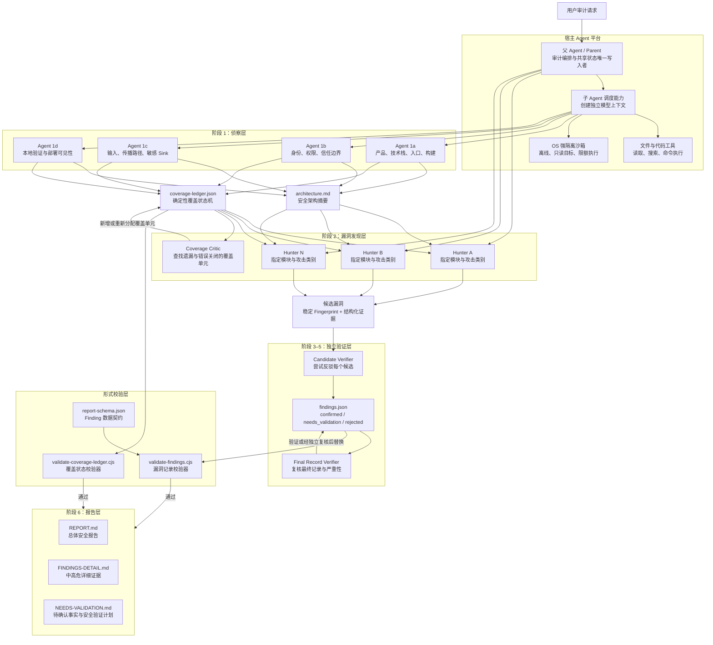
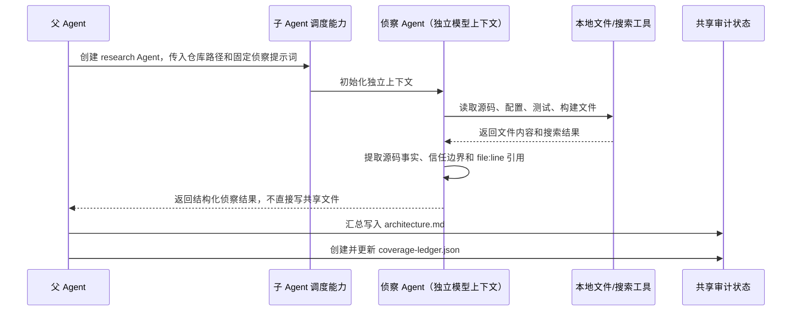
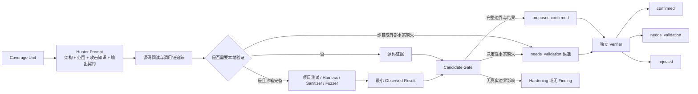
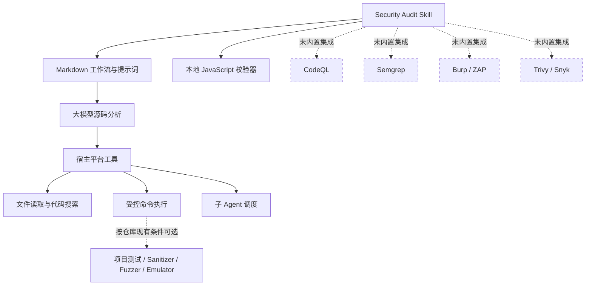
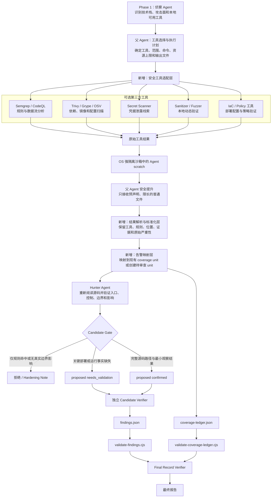

# Security Audit Skill 专业架构说明

## 1. 总体架构



## 2. 各架构层职责

| 架构层 | 组件 | 主要职责 | 是否直接检测漏洞 |
|---|---|---|---|
| 宿主平台层 | 父 Agent | 解析请求、选择审计模式、分配任务、维护预算和共享文件、汇总结论 | 间接 |
| 宿主平台层 | 子 Agent 调度能力 | 创建相互隔离的大模型上下文，并传入不同角色、范围和提示词 | 否 |
| 宿主平台层 | 文件与代码工具 | 读取源码、搜索符号和调用链、执行本地命令 | 提供检测基础 |
| 执行安全层 | OS 沙箱 | 隔离目标代码，禁止外网，限制资源，只允许写入指定 scratch | 否，负责安全执行 |
| 侦察层 | Agent 1a | 识别产品、技术栈、入口点、子系统、构建和测试方式 | 不产生正式漏洞 |
| 侦察层 | Agent 1b | 识别 principals、认证、授权、租户隔离、权限变化和信任边界 | 不产生正式漏洞 |
| 侦察层 | Agent 1c | 枚举低信任输入、数据转换、派生副本和安全敏感 sink | 不产生正式漏洞 |
| 侦察层 | Agent 1d | 判断哪些结论能本地验证、哪些依赖部署事实，以及沙箱能力是否足够 | 不产生正式漏洞 |
| 覆盖层 | Coverage Ledger | 用“入口 × 边界 × 子系统 × 攻击类别”表示审计范围和状态 | 否，证明检查覆盖 |
| 漏洞发现层 | Hunter Agent | 在指定 coverage unit 中深度追踪源码，产生候选漏洞或关闭覆盖单元 | 是 |
| 覆盖审查层 | Coverage Critic | 检查是否遗漏入口、平行路径、生命周期、攻击类别或历史问题 | 不直接确认漏洞 |
| 候选验证层 | Candidate Verifier | 由未参与发现的 Agent 重新阅读源码并尝试反驳候选 | 是，负责定性 |
| 记录复核层 | Final Record Verifier | 复核 trace、条件、影响、严重性、复现和修复建议 | 是，负责最终质量 |
| 形式校验层 | 两个 JavaScript Validator | 检查 JSON 结构、状态机、证据归属、ID、路径和严重性约束 | 否，不分析目标代码 |
| 报告层 | Markdown 报告 | 从验证后的结构化记录生成面向人的正式输出 | 否 |

## 3. 侦察 Agent 的具体实现方式

侦察 Agent 不是独立的安全软件，也不调用专用安全扫描 API。它是在 `RECONNAISSANCE.md` 中定义的四组固定提示词，由父 Agent 通过宿主平台的子 Agent 调度能力执行。



四个侦察角色的定义重点如下：

```text
Agent 1a：回答“系统是什么、从哪里进入、怎样在本地运行”。
Agent 1b：回答“谁拥有什么权限、哪些控制保护哪些资源”。
Agent 1c：回答“低信任数据从哪里进入、经过哪里、最终影响什么”。
Agent 1d：回答“哪些结论可以安全复现、哪些依赖源码之外的事实”。
```

它们的作用最终体现在：

1. `architecture.md` 为后续 Hunter 提供统一安全模型。
2. `coverage-ledger.json` 把侦察结果转换为可分配、可追踪、可验证的安全检查任务。
3. companion attack-class 选择根据侦察发现的真实边界决定，而不是只根据语言或依赖名称决定。

## 4. 漏洞发现与验证数据流



正式确认一个漏洞至少需要：

- 明确的低信任主体；
- 可控输入或动作；
- 本应生效的安全控制；
- 完整的源码路径；
- 被跨越的信任边界；
- 受影响的主体或资源；
- 本地受控环境中观察到的最小结果；
- 独立 Agent 的复核。

## 5. 工具与 API 边界



结论：该 skill 没有内置第三方安全扫描 API。漏洞发现主要由大模型进行源码语义分析；宿主平台提供文件、命令和子 Agent 能力；项目现有测试或安全工具只在满足离线与沙箱条件时作为可选验证手段；JavaScript 校验器仅检查审计结果的一致性，不负责发现漏洞。

### 假设扩展：加入第三方安全工具后的流程（当前未实现）

> 以下流程是基于现有架构的扩展设计，不属于当前 skill 的真实实现。当前仓库没有工具选择器、调用适配器、结果解析器或告警映射代码。



扩展后仍需维持现有证据规则：第三方工具告警只能作为候选线索，不能直接成为 `confirmed`；工具自身的严重性不能直接替代 skill 基于实际影响生成的严重性；两个 JavaScript 校验器仍只验证最终产物结构和内部一致性，不验证扫描器告警是否真实。

## 6. Agent 角色定义位置

| 角色 | Agent 类型 | 定义位置 | 具体定义内容 | 调度与输出 |
|---|---|---|---|---|
| 父 Agent（Parent） | 当前主 Agent / 编排者 | `SKILL.md` 的 `Platform terminology`、`Full audit setup` 和 `Full audit workflow` | 负责模式选择、预算门控、Agent 分配、共享状态写入、候选合并、校验和报告生成 | 由用户请求触发；是共享审计文件的唯一写入者 |
| Agent 1a：Product, stack, and local operation | `research` | `RECONNAISSANCE.md:9` | 识别产品、技术栈、入口、子系统、构建测试命令和本地工具限制 | Parent 在 Phase 1 并行启动；返回带 `file:line` 的源码事实 |
| Agent 1b：Principals, authority, and controls | `research` | `RECONNAISSANCE.md:22` | 识别 principal、认证、授权、租户隔离、权限变化和源码不可见控制 | Parent 在 Phase 1 并行启动；返回信任边界和控制位置 |
| Agent 1c：Entry surfaces, copies, and sinks | `research` | `RECONNAISSANCE.md:35` | 枚举外部输入、数据转换、存储或派生副本以及安全敏感 sink | Parent 在 Phase 1 并行启动；返回入口到 sink 的源码路径 |
| Agent 1d：Local execution and deployment visibility | `research` | `RECONNAISSANCE.md:44` | 判断本地验证方式、禁止执行项、部署不可见事实、沙箱及 artifact promotion 能力 | Parent 在 Phase 1 并行启动；返回可执行性和验证 blocker |
| Hunter Agent | `general` | `HUNTING.md` 的 `Phase 2: Run coverage-led hunting waves` 和 `Required hunter prompt` | 根据分配的 coverage unit、攻击类别和 companion 内容深度追踪源码，返回 covered、candidate 或 blocked | Parent 按 wave 分配；每个 Hunter 只处理自己的 coverage IDs |
| Coverage Critic | `research` | `HUNTING.md:221` 的 `Coverage-critic waves` | 查找未建模入口、平行路径、生命周期遗漏、不合理排除和错误关闭的 unit | 每个 Hunter wave 后由 Parent 启动；输出 missing units 和 reassign IDs |
| Candidate Verifier | `general` | `VALIDATION-AND-REPORTING.md:3` 和 `Candidate-verifier prompt` | 独立尝试反驳候选，重新检查源码和最小复现，判定 confirmed、needs_validation 或 rejected | 每个唯一 fingerprint 使用未参与发现的新 Agent |
| Final Record Verifier | `research` | `VALIDATION-AND-REPORTING.md:120` 的 `Phase 5` | 复核最终结构化记录中的 trace、条件、观察结果、影响、严重性和修复建议 | 对每个最终 confirmed 和 needs_validation 记录执行；material replacement 需要再次独立复核 |

> 这些角色都不是仓库中的 JavaScript 类或独立可执行程序。它们通过 Markdown 中的角色说明、固定提示词、上下文范围和输出契约定义，再由宿主平台的子 Agent 调度能力创建对应的大模型上下文。

## 7. 关键文件对应关系

| 文件 | 架构作用 |
|---|---|
| `SKILL.md` | 总体策略、模式、预算、安全边界和六阶段入口 |
| `RECONNAISSANCE.md` | 定义四类侦察 Agent 及 Coverage Ledger |
| `HUNTING.md` | 定义 Hunter、Coverage Critic、候选输出和证据规则 |
| `VALIDATION-AND-REPORTING.md` | 定义独立验证、最终复核和报告生成 |
| `ATTACK-CLASSES.md` | 通用攻击类别知识库 |
| 各领域 companion `.md` | Web、AI、云、供应链、IPC、内存安全等专项知识 |
| `report-schema.json` | `findings.json` 数据契约 |
| `validate-findings.cjs` | Finding 结构与语义一致性校验 |
| `validate-coverage-ledger.cjs` | Coverage 状态机与证据归属校验 |
