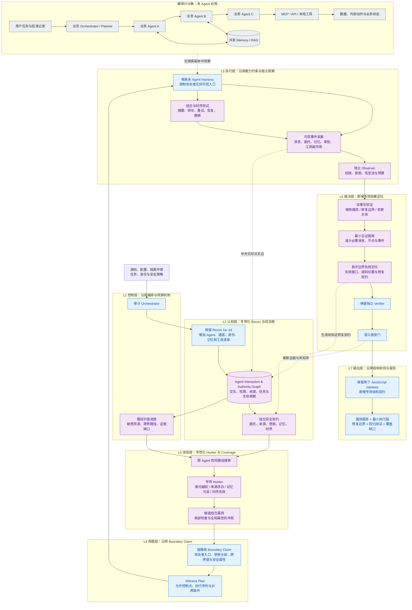

# 多 AI Agent 专项方案：基于组合安全契约与端到端见证的审计架构

## 1. 研究定位与现有架构的关系

本方案以**多 Agent 应用为被审计对象**，沿用《证据驱动自适应 LLM 安全审计架构》，将其专项化为：

> 自动发现、验证和定位多 Agent 协作中，由消息传递、任务委托、共享记忆和工具执行共同造成的安全边界违反。

核心研究问题是：

**每个 Agent 单独通过安全检查，为什么组合成系统后仍可能越权？如何自动找到这样的执行链？**

例如：

```text
攻击者控制的文档
→ 检索 Agent 读取
→ 分析 Agent 摘要
→ Planner 将摘要解释成任务指令
→ 执行 Agent 使用用户权限调用工具
→ 出现用户未请求的外部动作
```

问题可能发生在中间的信任转换，而最终工具调用的用户身份和资源权限检查都合法。因此必须同时检查**资源授权**和**用户意图绑定**。

当前 Skill 的 [AI-AND-LLM.md](/Users/daitongmin/.codex/skills/security-audit/AI-AND-LLM.md) 已包含这些检查原则，但主要以提示词和源码审查要求实现。本方案把它们升级为图模型、契约检查、路径搜索和执行验证机制。

跨 Agent 注入已经由 *Prompt Infection* 研究；2026 年 10 月 5 日发布的 multi-CaMeL 预印本进一步展示了单 Agent 防护不能自动组合，并提出跨边界来源保留协议。因此，本文将**组合漏洞的自动审计、最小见证和失效定位**作为拟研究贡献；其原创性仍需通过完整文献比较与实验确认。[Prompt Infection](https://arxiv.org/abs/2410.07283)、[multi-CaMeL](https://arxiv.org/abs/2610.05640)。

## 2. 专项总体架构

蓝色组件沿用既定架构；紫色组件是本次新增的多 Agent 专项机制。右侧展示被审计系统，避免把“审计 Agent”与“业务 Agent”混淆。



现有组件的变化可直接对应为：

| 现有机制 | 多 Agent 专项变化 |
|---|---|
| Recon 1a–1d | 增加 Agent 身份、交互通道、凭据、共享状态和委托关系 |
| Architecture / Belief Graph | 增加任务、消息来源、权限继承与时序边 |
| Coverage Ledger | 按“跨界链路 × 安全属性 × 生命周期”建立覆盖单元 |
| Hunter | 搜索组合后才成立的漏洞，重点检查 Agent 之间的接口 |
| Boundary Claim | 从单入口命题扩展为多跳委托和数据传播命题 |
| Capability Witness | 限制测试只能修改攻击者真正可控的文档、消息或服务响应 |
| Independent Observer | 检查最终副作用，并追溯用户、任务与授权链 |
| Verifier | 独立重放整条链，验证失效位置与反事实 |
| 报告 | 输出最小攻击链、首次失效边界、修复点和回归测试 |

## 3. 核心理论与机制

### 3.1 建立交互—权限—来源联合图

定义：

\[
G=(V,E_{\mathrm{message}},E_{\mathrm{delegate}},
E_{\mathrm{memory}},E_{\mathrm{tool}})
\]

节点包括业务 Agent、用户、任务、记忆对象、工具和资源。

每条边记录：

```text
实际发送者与接收者
原始用户与租户
任务及父任务
数据来源与信任标签
委托权限范围
审批引用
源码位置
运行时事件引用
```

**实际调用身份、原始用户和内容来源必须分别记录。**“消息来自内部 Agent”不意味着其内容来自可信用户。

先由源码和配置构建候选图，再用运行轨迹补充实际路径；无法确定的边标记为未知。

### 3.2 五类组合安全契约

| 契约 | 必须成立的属性 | 典型失效 |
|---|---|---|
| 委托权限契约 | 子任务获得的权限符合显式委托范围 | 转交时继承全部凭据或错误使用服务身份 |
| 来源契约 | 转发、摘要、合并不自动提升内容信任等级 | 外部文档经摘要后被当作系统指令 |
| 动作意图契约 | 最终副作用属于用户任务或有效审批范围 | 用户只要求分析，系统却发送或修改 |
| 记忆隔离契约 | 写入、读取与消费均符合主体和任务范围 | 攻击内容被持久化后影响另一会话 |
| 生命周期契约 | 重试、恢复、撤销和并发保持上述属性 | 参数变更复用旧批准，恢复后继续使用已撤销权限 |

委托收缩可写为：

\[
C_{child}\subseteq
C_{delegated}\cap C_{role}\cap C_{resource}
\]

此式适用于同一授权链。若子 Agent 使用另一主体独立授予的权限，必须建立新的授权依据，并继续检查该动作是否符合用户任务；不能简单归为权限继承。

最终副作用的接受条件是：

\[
Allow(x)=
ResourceAuthorized(x)
\land IntentBound(x)
\land LifecycleValid(x)
\]

自然语言任务不能普遍、精确地自动编译成权限。首版使用明确任务模板、结构化授权和审批对象；无法消除的语义歧义交由人工确认。

### 3.3 跨链组合漏洞搜索

核心搜索目标：

\[
\exists \tau:
\left(\bigwedge_i LocalCheck_i(\tau)\right)
\land \neg GlobalProperty(\tau)
\]

也就是：**局部检查均放行，但端到端安全属性失败。**

首版采用可实现的有界搜索：

1. 从发送、写入、删除、敏感读取等终端操作反向追踪；
2. 找出涉及消息转交、来源转换、共享记忆或授权变化的路径；
3. 使用图搜索和规则检查筛选候选；
4. 用 LLM 解释上下文、提出触发假设；
5. 用隔离执行验证，不把图上可达直接视为漏洞。

图分析负责有限抽象中的检查；LLM 行为通过实验观察。模型检查通过不能证明任意自然语言输入安全。

### 3.4 端到端见证与失效定位

每个确认结果包含：

```text
攻击者实际控制点
→ 原始内容
→ 中间摘要或消息
→ 来源或权限变化
→ 工具请求
→ 最终副作用
```

观察器必须独立读取可信事件和业务状态。Agent 自己声称“已发送”“已批准”不能作为成功证据。

通过逐步删除消息、替换中间响应、修复单个边界，寻找：

- 必要的攻击输入；
- 必要的 Agent 和传播边；
- 首次违反来源、权限或意图契约的位置；
- 阻断该链所需的最小修复。

结果称为**在给定测试集和缩减方法下的最小见证**，不宣称得到全局最短攻击路径。

## 4. 专项审计流程与案例

首版覆盖四类架构：串行流水线、层级委托、共享记忆协作、并行结果汇聚。优先审计三种效果：未请求副作用、跨主体数据泄露、错误持久化。

| 检查方向 | 攻击者控制点 | 确认所需效果 |
|---|---|---|
| 消息来源洗白 | 外部资料、低信任 Agent 返回 | 内容经转交后驱动未授权或未请求动作 |
| 委托越权 | 子任务参数、资源标识 | 子 Agent 使用超出委托范围的权限 |
| 共享记忆污染 | 可写记忆、摘要或缓存 | 后续另一任务或主体受到实际影响 |
| 身份与结果混淆 | 消息、请求 ID、服务元数据 | 错误结果或凭据被绑定到另一任务 |
| 审批失效 | 重试、参数更新、恢复事件 | 旧批准授权了变更或重复副作用 |
| 委托预算失效 | 子任务数量、循环和重试 | 全局预算被绕过，以有限模拟计数验证 |

协议身份验证仍需要应用级语义检查。例如 A2A 的任务授权状态本身不代表具体操作已获批准；MCP 也要求令牌绑定正确的服务 audience。专项审计必须继续检查用户、任务、资源和动作的对应关系。[A2A 规范](https://a2a-protocol.org/latest/specification/)、[MCP 授权规范](https://modelcontextprotocol.io/specification/2026-07-28/basic/authorization)。

贯穿案例采用“企业报告 Agent”：

```text
用户批准：读取报告并生成摘要
外部文档 → Retriever → Analyst → Planner → Executor → 邮件工具
```

实验用虚拟报告、模拟邮箱和独立收件箱记录。若最终出现未请求的发送事件，则分别验证：

- 移除文档中的攻击因素；
- 保留事实内容并限制 Analyst 输出为数据；
- 在 Planner 到 Executor 之间加入动作绑定；
- 在用户明确批准相同发送动作后执行合法对照。

由这些实验判断失效发生在来源提升、任务规划还是执行审批边界。合法主体本来有发送权限，也不能替代对发送意图的验证。

工业实现首版提供五个接口：

| 接口 | 最小职责 |
|---|---|
| `TargetAdapter` | 导出拓扑、身份、工具、任务状态和源码引用 |
| `BoundaryContract` | 定义委托、来源、意图、记忆和生命周期属性 |
| `TraceEvent` | 关联 Agent、用户、任务、消息、权限与副作用 |
| `WitnessSpec` | 声明攻击者可控入口、事件序列和对照组 |
| `AuditFinding` | 输出违反属性、执行链、失效位置与证据引用 |

源码固定在具体提交；业务环境全部使用隔离状态和模拟外部副作用。模型调用与目标工具网络分开，由受控模型网关提供响应。

## 5. 创新定位、实验与交付

**能力隔离、消息签名、来源标记和提示注入检测分别已有研究。**签名只能证明消息来源与完整性，不能证明语义可信；本方案的拟贡献集中在以下三个组合机制：

1. **组合安全契约审计**：自动寻找局部放行、全局越界的委托和数据传播链。
2. **跨 Agent 变换测试**：以摘要、转交、合并、记忆保存、重试和恢复为测试变换，检查安全属性是否保持。
3. **最小因果见证与修复定位**：把成功攻击缩减为可审查链路，并定位首次契约失效及对应源码控制点。

基线包括当前 Skill 的 AI 专项流程、仅源码审查、仅黑盒提示注入测试，以及源码加普通动态验证。完整方案与这些基线使用相同攻击预算和候选集合。

防御基线纳入能力约束与来源保留机制；CaMeL、CapScope 和 multi-CaMeL 是必须比较的相关工作。基于这些系统的结论应遵循其各自假设与实验范围。[CaMeL](https://arxiv.org/abs/2503.18813)、[CapScope](https://arxiv.org/abs/2609.08371)、[multi-CaMeL](https://arxiv.org/abs/2610.05640)。

首轮数据集设为：

- 4 种拓扑、6 类失效、每类至少 2 个实例，共 48 个受控案例；
- 每例包含漏洞配置、修复配置及合法任务对照；
- 使用 2 个模型家族，每条件重复 5 次；
- 增加至少 6 个公开多 Agent 应用，单独报告真实应用结果；
- 合成、植入和真实发现分开统计。

主要指标：

- 组合漏洞检出率、错误确认率；
- 首次失效边界定位准确率；
- 见证缩减程度与重放成功率；
- 修复后攻击成功率；
- 合法任务完成率和错误阻断率；
- 单个确认结果成本与人工复核时间。

消融分别移除联合图、组合契约、生命周期测试、反事实实验和见证缩减，测量各机制的增益。提示注入实验可借鉴 AgentDojo 的任务与攻击分离方法，但新增多跳委托和生命周期案例，并检查与 MultiAgentDojo 的重复覆盖。[AgentDojo](https://github.com/ethz-spylab/agentdojo)。

执行安排：

| 阶段 | 时间 | 交付 |
|---|---|---|
| 问题验证 | 2 周 | 8 个先导案例，确认组合失效及可观察效果 |
| 图与契约原型 | 4 周 | 拓扑提取、契约定义、有界路径搜索 |
| 动态验证原型 | 4 周 | 隔离 Harness、可信轨迹、Observer、对照实验 |
| 实验与工件 | 6 周 | 数据集、消融、真实应用验证、可重放结果 |

停止和接受规则固定为：确认必须同时具有源码依据、攻击者能力合规、可观察边界违反和独立复核；缺失关键部署事实进入 `needs_validation`；测试越权、观察器错误和证据冲突分别保留为内部失败状态。未发现漏洞的结果报告已测路径、变换和剩余未知项。

方案最终形成的架构能力是：

**从 Agent 节点检查，扩展到跨 Agent 委托链、数据链和生命周期的组合安全审计，并为每项结论提供端到端见证与失效定位。**
