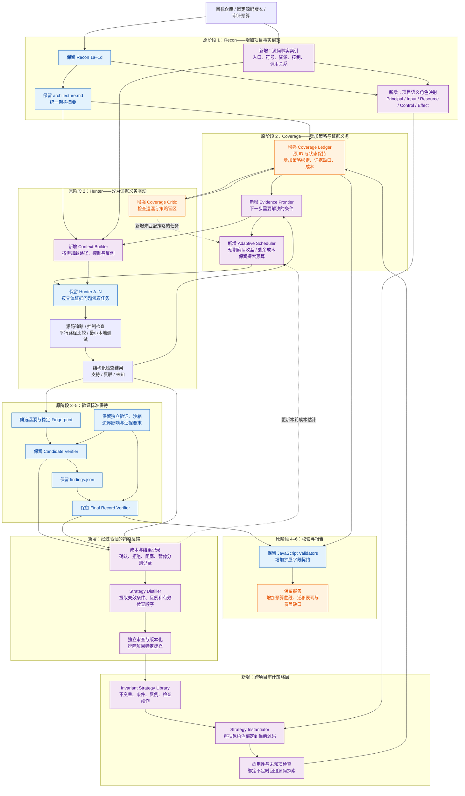

# 安全不变量驱动的自适应漏洞发现：面向效率与跨项目泛化的架构方案

## 1. 研究目标与理论主线

本方案以原始 Cloudflare Security Audit Skill 为基线，保留：

```text
Recon → Coverage Ledger → Hunter → Coverage Critic
→ Candidate Verifier → Final Record Verifier → Report
```

研究目标是：

**在保持漏洞确认标准不变的前提下，用更少的代码阅读、模型调用和验证成本，发现更多真实漏洞，并将有效审计方法迁移到未见项目与框架。**

第一阶段采用 Python、TypeScript 服务端项目，以跨项目、跨框架泛化为主要目标。跨语言和未见漏洞机制作为后续扩展，分别验证。

### 1.1 核心科学问题

现有审计中，大模型经常重复完成：

```text
理解框架
→ 找入口
→ 找资源
→ 找控制
→ 追踪路径
→ 判断缺失条件
→ 构造验证
```

这些步骤同时包含两种不同知识：

- **项目知识**：当前仓库的路由、数据模型、中间件和具体接口；
- **审计知识**：检查什么安全不变量，以及用什么证据建立或反驳漏洞命题。

本方案将二者分离：

\[
AuditPlan(P)=Instantiate(Strategy,\ Facts(P))
\]

其中：

- \(Strategy\)：可复用的安全不变量、成立条件、反例和证据获取动作；
- \(Facts(P)\)：当前项目的源码事实；
- \(Instantiate\)：将策略中的语义角色绑定到当前项目的具体对象。

泛化来自**审计策略的迁移和重新实例化**；效率来自**避免重复推导，以及把计算集中在尚未建立的关键条件上**。

### 1.2 优化目标

对每个仓库，在总预算 \(B\) 下最大化独立确认的唯一根因数：

\[
\max_{\pi}\ \mathbb{E}[N_{\mathrm{confirmed}}(\pi,B)]
\]

同时约束：

\[
FDR(\pi)\leq \epsilon,\qquad
Cost(\pi)\leq B
\]

这里的收益以独立确认结果为准。候选数量、Coverage 状态变化和模型自评不作为等价收益。

风险等级作为辅助排序；主实验按唯一根因等权计数，避免通过选择严重度权重改变结论。

---

## 2. 在现有架构上的完整演进图

蓝色表示保留的原有组件，紫色表示新增机制，橙色表示增强后的原有组件。



具体变化：

| 原有机制 | 当前已经具备 | 本方案增加 |
|---|---|---|
| Recon | 技术栈、入口、边界与验证条件识别 | 可查询事实索引和语义角色绑定 |
| 不变量驱动 Hunter | 明确主体、控制、路径和结果 | 可实例化、可迁移的策略对象 |
| Coverage 排序 | 风险、历史缺口、变化源码等排序 | 根据实时证据缺口和剩余验证成本更新 |
| 同类变体搜索 | 在分配范围内检查词法、结构与逻辑变体 | 将策略迁移到未见项目，并检查适用条件 |
| 历史结果复用 | 同仓库记录对比与重新验证 | 跨仓库复用抽象检查方法，不复用漏洞结论 |
| Critic | 检查遗漏和错误关闭单元 | 检查策略库未覆盖的模式与过度集中 |
| 独立验证 | 候选和最终记录复核 | 保持标准，回传实际收益、失败原因和成本 |

因此，“使用不变量”和“风险排序”本身不作为创新。新增重点是**策略如何表示、迁移、实例化，以及预算如何根据证据动态分配**。

---

## 3. 三个核心机制

### 3.1 机制一：可实例化的安全审计策略

策略不是一段旧漏洞描述，而是一个可执行的检查计划：

```text
Invariant
  应当成立的安全关系

Semantic Roles
  主体、输入、资源、控制、敏感操作

Applicability
  策略适用的前置条件

Proof Obligations
  确认或反驳命题需要建立的事实

Counterexamples
  哪些控制或条件会使假设不成立

Evidence Actions
  在哪里读代码、比较什么路径、运行什么最小检查

Stop Conditions
  什么证据允许停止当前调查
```

以对象级授权为例：

```text
不变量：
对资源执行操作前，必须检查请求主体对该具体资源的权限。

语义角色：
requester → resource_selector → resource_lookup → authorization → operation

证据义务：
1. selector 可由低信任主体影响；
2. selector 能选择非所属资源；
3. 完整路径没有有效资源级授权；
4. 操作产生跨主体影响。

反例：
统一查询层已绑定 owner/tenant；
数据源已在源码可证条件下强制资源隔离；
该操作按产品设计允许公开访问。
```

在不同框架中，策略不变，但角色绑定不同：

```text
项目 A：路由 → 依赖注入 → ORM 查询 → 授权函数
项目 B：Controller → Guard → Service → Repository
项目 C：消息处理器 → 主体解析 → 资源查询 → 状态更新
```

每次绑定必须有当前项目的源码依据。历史框架知识只提供搜索起点，不能代替当前代码事实。

**效率收益：**复用检查问题、反例和调查顺序。

**泛化收益：**降低对函数名、框架 API 和旧漏洞代码片段的依赖。

### 3.2 机制二：证据义务导航与上下文构建

每个调查对象维护：

\[
O(H)=\{o_1,o_2,\ldots,o_k\}
\]

每个义务仅有：

```text
supported / refuted / unknown
```

Hunter 接收的任务变为具体问题，例如：

> 查明当前资源查询是否始终绑定请求租户，并检查批量操作是否走相同控制。

上下文分为三部分：

- **固定上下文**：原有安全规则、架构摘要、攻击类别和输出契约；
- **当前证据上下文**：相关源码、调用方、控制层、必要配置；
- **反例上下文**：可能推翻候选的中间件、策略和替代路径。

固定规则完整保留。上下文裁剪只作用于项目代码，并提供继续展开入口；未知动态调用、反射和生成路径显式保留。

检查动作按当前缺口展开：

```text
不知道输入是否可控 → 查入口与参数来源
不知道控制是否存在 → 查中间件、查询层和调用方
不知道路径是否可达 → 查分支条件与调用关系
不知道影响是否成立 → 构造最小本地验证
关键事实在仓库之外 → needs_validation
```

证明某个当前候选不成立，只能关闭该候选；Coverage Unit 仍需完成其余检查义务。

**效率收益：**减少无目标阅读、重复读取及过早生成复杂 PoC。

**泛化收益：**导航依据证据关系，不依赖固定文件目录和函数命名。

### 3.3 机制三：验证成本感知的自适应调度

调度对象为：

\[
Task=(CoverageUnit,\ Strategy,\ MissingObligation)
\]

排序依据：

\[
Score(a)=
\frac{
\widehat{P}_{confirm}(a)
+\lambda\,UncertaintyBonus(a)
}{
\widehat{Cost}_{remaining}(a)
}
\]

其中：

- \(\widehat{P}_{confirm}\)：当前证据状态下最终确认的经验估计；
- \(UncertaintyBonus\)：陌生策略、框架和低样本任务的探索奖励；
- \(\widehat{Cost}_{remaining}\)：从当前步骤到完成确认所需的预计成本。

这是一项待校准的调度机制，不声称公式天然最优。

首版实现采用可解释的正则化模型：

- 分类模型估计确认概率；
- 成本回归估计剩余 Token 和耗时；
- 特征包含已建立的证据义务、路径长度、未知控制、测试设施和重复程度；
- 不使用项目名、CVE 编号等识别捷径；
- 低样本情况下回退原 Skill 的风险排序。

默认调度：

- 80% 发现预算用于当前优先任务；
- 20% 用于未匹配策略、陌生模块与低样本区域；
- 单任务按最多 4 次模型调用或 12,000 Token 的工作片段执行，到安全检查点后重新调度；
- 暂停任务保存事实和未解决问题，不能标为 `covered` 或 `rejected`。

以上比例与片段大小在开发集调整一次后冻结。

收益标签只能来自独立验证：

```text
confirmed → 唯一根因收益
rejected → 当前命题被反驳
blocked / needs_validation → 事实缺失
paused / deferred → 尚未完成
duplicate → 不增加唯一根因收益
```

后三类不能作为“没有漏洞”的负样本。

已有研究已经关注证据引导与难度感知搜索，因此自适应调度本身不作为首创主张。本文重点研究其与可迁移策略、证据义务和确认成本的联合效果。[难度感知搜索研究](https://arxiv.org/abs/2602.17622)。近期 RedHerring 预印本也提示：假设生成便宜、验证昂贵，安全的诱饵路径可能消耗大量预算，实验需要检查这种效率退化。[RedHerring](https://arxiv.org/abs/2609.35909)。

---

## 4. 完整执行与工业实现

### 4.1 执行流程

1. **固定输入。**锁定源码提交、审计范围、模型、策略库版本与总预算。
2. **完成原有 Recon。**四类侦察结果生成架构摘要，同时建立源码索引和角色映射。
3. **实例化策略。**为每个边界绑定适用策略；无匹配策略的区域仍进入探索任务。
4. **创建 Coverage。**保留原 canonical ID 和状态机，附加策略、证据义务、成本与任务引用。
5. **分片调查。**Hunter 解决具体证据问题，结果进入调度器和 Parent 管理的账本。
6. **执行 Critic。**保留原 profile 的必需审查，检查遗漏、绑定错误和搜索过度集中。
7. **生成候选。**只有达到原候选门槛，才进入独立验证。
8. **独立确认。**保留 Candidate Verifier 和 Final Record Verifier；验证者不接收调度概率作为判断依据。
9. **生成报告。**原 Validators 校验通过后输出，同时记录成本、暂停任务和覆盖缺口。
10. **审查策略反馈。**经过确认或明确反驳的案例用于更新策略；跨项目经验发布前进行独立审查。

### 4.2 预算控制

- 总成本包含 Recon、索引、检索、Hunter、Critic、工具执行和两阶段验证。
- 初始为验证保留至少 30% 可变预算，并单独预留原 profile 的必需 Critic 成本。
- 每个新候选进入队列时，按开发集验证成本的保守估计增加预算预留。
- 预留不足时停止新增调查，优先完成验证。
- 无法完成的候选保留原 Skill 的未完成状态与披露要求，不降低确认标准。

### 4.3 最小接口

| 接口 | 职责 |
|---|---|
| `AuditStrategy` | 不变量、适用条件、语义角色、义务、反例和动作 |
| `StrategyBinding` | 抽象角色对应的当前源码位置与未知项 |
| `EvidenceTask` | Coverage ID、待解决义务、输入证据与检查点 |
| `OutcomeRecord` | 独立结论、唯一根因、实际成本、失败原因 |

策略库、索引和任务缓存按源码、策略及工具版本绑定。代码变更时，相关绑定失效并重新检查。

跨项目经验保留抽象条件、检查方法和失败教训；企业私有代码与凭据不进入公共策略库。

第一版不训练基础大模型。训练仅限小型调度模型；LLM 使用现有 API。模型升级后重新校准调度成本，并运行固定回归集。

---

## 5. 泛化定义与实验协议

### 5.1 分别验证四种能力

| 能力 | 测试方式 | 第一版定位 |
|---|---|---|
| 跨项目 | 项目、fork 与同源代码族整体留出 | 主目标 |
| 跨框架 | 某框架及其项目完全不进入策略学习与校准 | 主目标 |
| 实现变体 | 重命名、函数抽取、控制位置迁移等经验证变换 | 主目标 |
| 未见机制／跨语言 | 额外留出机制或语言 | 探索实验 |

跨框架测试允许 Recon 阅读目标源码和本地文档，但不允许加入为该测试框架手工编写的新适配规则。

**已知不变量适用于新框架，不等于发现了从未见过的漏洞机制。**这些结论分开报告。

### 5.2 数据集

目标规模：

- 至少 24 个项目，覆盖两种语言及每种语言至少 3 个框架；
- 至少 60 个有独立依据、可本地验证的已知漏洞；
- 每个漏洞配套修复版本；
- 对可验证的案例增加保持漏洞性质的实现变体；
- 真实漏洞、人工植入和变体分别统计。

若案例数量不足，缩减框架范围并披露，不用不可执行样本补齐。

项目来源按 12／6／6 分为策略构建、校准和封存测试集；同源项目不得跨组。另设留一框架实验，每轮完全排除该框架的历史案例，重新构建策略和调度参数。

CVE、补丁、PoC 和漏洞位置不提供给被评测审计系统，使用独立评测侧维护。公开模型的预训练污染不能完全排除，因此增加近期案例、盲测项目和实现变体，并明确这一限制。

既有研究发现，漏洞检测器可能依赖无关代码特征，且不能可靠区分漏洞版与修复版。因此本方案同时要求“保持漏洞性质的变换后结果稳定”与“修复后判断改变”。[USENIX Security 2024](https://www.usenix.org/conference/usenixsecurity24/presentation/risse)。

### 5.3 对照与消融

核心基线：

- B0：原始 Skill 的 standard 流程；
- B1：原始 Skill 加相同源码索引；
- B2：索引加普通案例检索；
- B3：索引加不变量策略，保留原固定排序；
- B4：完整策略实例化、证据导航和自适应调度。

所有方法使用相同模型、工具权限、并发数和确认标准。主实验固定模型，跨模型复现实验再使用第二模型家族。

分别移除策略实例化、反例、按需上下文、成本估计和探索配额。另做普通检索与策略实例化的直接比较，检验收益是否仅来自检索更多资料。

实验测试三个总 Token 预算：100k、250k、500k，每条件至少重复三次；先导阶段确认最低预算能容纳必要流程后再冻结。壁钟时间、美元和工具 CPU 时间独立报告。

---

## 6. 指标、假设与创新边界

### 6.1 效率指标

主指标：

\[
Yield(B)=
\text{预算 }B\text{ 下独立确认的唯一根因数}
\]

同时报告：

- 发现数量—预算曲线及曲线面积；
- 首个确认漏洞时间；
- 每个确认漏洞的总成本；
- 重复调查比例；
- 无效候选的验证成本；
- 已知漏洞集合上的检出率；
- 人工复核准确率。

开放仓库中全部真实漏洞数量未知，因此不声称总体 Recall；只报告已标注集合检出率和新发现的独立确认结果。Cloudflare 博客同样指出了未知漏洞总量带来的评测限制。[Cloudflare 博客](https://blog.cloudflare.com/build-your-own-vulnerability-harness/)。

### 6.2 泛化指标

- 未见项目、框架上的预算约束检出率；
- 熟悉框架与未见框架的性能差；
- 修复版本错误确认率；
- 实现变体前后的结果一致性；
- 策略绑定成功率与人工适配时间；
- 负迁移：错误套用历史策略造成的成本或漏检。

统计以项目／代码族为聚类单位，报告置信区间和效应量。策略库在封存测试前冻结；测试运行经验不传入后续测试项目。

### 6.3 可证伪的研究假设

- H1：策略实例化比普通案例检索更能迁移到未见框架。
- H2：证据义务导航减少重复阅读和提前开展的无效 PoC。
- H3：成本感知调度在相同预算下提高确认漏洞数。
- H4：探索配额缓解历史成功策略造成的搜索偏置。
- H5：效率增益在加入修复版本、实现变体和独立验证后仍然成立。

### 6.4 拟研究贡献

论文主线集中为：

> 将漏洞审计经验表示为可迁移的证据获取策略，并根据策略在目标项目中的实例化状态，动态选择最有价值的调查动作。

具体贡献：

1. **表示与迁移机制**：从案例文本和固定攻击类别，提升为带适用条件、反例和证据义务的审计策略。
2. **联合调度机制**：将项目绑定结果、证据缺口和剩余确认成本共同用于预算分配。
3. **评测协议与实证发现**：同时检验效率、修复敏感性、实现变体稳定性和跨框架迁移。

IRIS 已研究 LLM 推断污点规格与静态分析结合；VulAgent 已研究假设条件和触发路径验证。这些属于必须比较的相关工作。本方案的区别需要落实在**跨项目策略迁移和预算收益**上，而非仅增加 Agent 角色。[IRIS](https://proceedings.iclr.cc/paper_files/paper/2025/hash/582d4e27fa24168f3af1f4582655034b-Abstract-Conference.html)、[VulAgent](https://aclanthology.org/2026.findings-acl.928/)。

---

## 7. 实施路线与默认决策

| 阶段 | 时间 | 交付与决策依据 |
|---|---|---|
| 先导分析 | 4 周 | 6 个项目，测量重复阅读、无效验证和跨框架绑定失败 |
| 表示原型 | 4 周 | 源码索引、策略对象、绑定器和证据任务 |
| 调度原型 | 4 周 | 检查点、成本模型、探索配额和验证预算预留 |
| 数据与实验 | 6 周 | 项目留出、框架留出、修复版和变体评测 |
| 工业复核 | 4 周 | 真实新项目、人工复核、增量审计与成本归因 |
| 论文工件 | 2 周 | 冻结版本、复现实验和公开工件 |

先导阶段需回答三个决定性问题：原始流程主要浪费在哪里、策略能否绑定未见框架、绑定是否实际减少调查成本。若主要瓶颈是构建环境而非搜索，则调整研究重点，不能继续用调度解释全部效率问题。

默认选择：

- 通用代码审计，第一阶段优先跨项目与跨框架；
- 保留原六阶段骨架、canonical Coverage ID 和独立验证标准；
- 新增策略对象、事实绑定、证据导航和预算调度；
- 策略迁移不自动继承旧漏洞结论；
- 无匹配策略的区域保留独立探索；
- 性能改善属于待实验验证的假设；
- 首版使用公开仓库与模型 API，不依赖基础模型训练集群。

最终架构形成一条可验证的机制链：

**可复用审计策略 → 当前项目事实绑定 → 证据缺口定位 → 成本感知调查 → 独立确认 → 经过审查的策略更新。**
