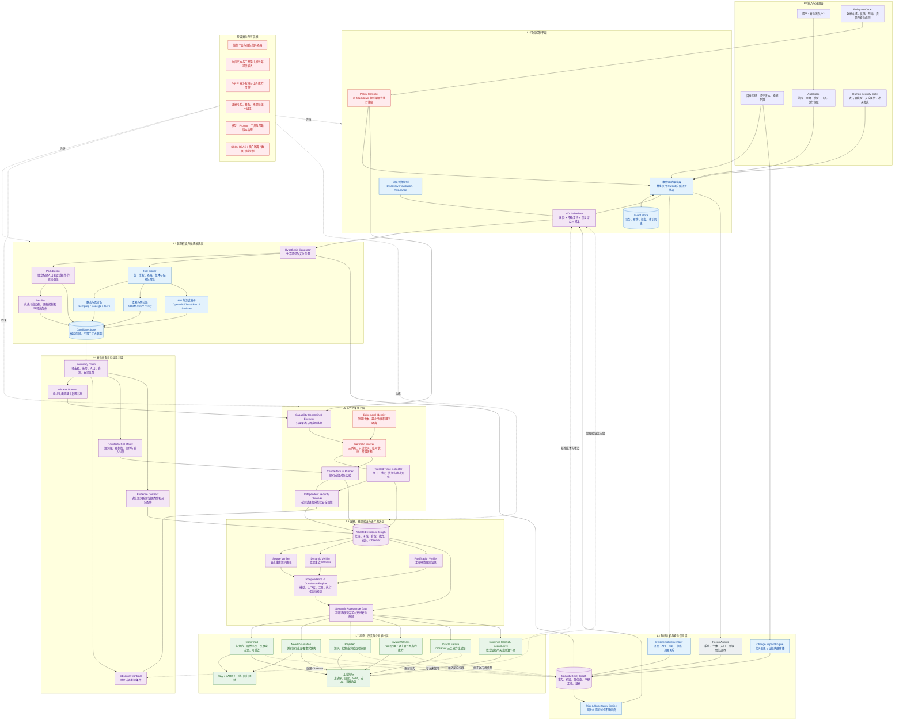
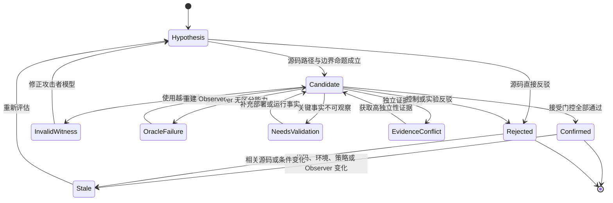

# 证据驱动自适应 LLM 安全审计架构

## 1. 一图总览

图例：

- 灰色：现有 Security Audit Skill 已有机制
- 蓝色：对现有机制的工程优化
- 紫色：本文提出的核心创新机制
- 红色：跨层安全控制
- 绿色：最终状态与企业输出



---

## 2. 架构核心变化

现有 Skill 的核心链路是：

```text
Recon → Coverage Ledger → Hunter → Verifier → JSON Validator → Report
```

优化后的核心链路是：

```text
系统事实
→ 安全信念图
→ 风险与不确定性计算
→ 信息价值调度
→ 可证伪漏洞假设
→ 攻击者边界声明
→ 能力约束执行
→ 独立安全属性观察
→ 反事实验证
→ 相关性校正裁决
→ 更新安全信念
```

本质变化不是增加更多 Agent，而是将系统从**线性多 Agent 工作流**升级为**证据驱动的闭环决策系统**。

---

## 3. 七层架构职责

| 层级 | 解决的问题 | 关键机制 |
|---|---|---|
| L0 输入与治理 | 审计什么、允许做什么 | AuditSpec、策略、人工安全门 |
| L1 可信控制平面 | 如何可靠编排和恢复 | Policy Compiler、事件存储、分层预算 |
| L2 系统认知层 | 系统已知什么、还不知道什么 | Security Belief Graph、风险与不确定性 |
| L3 假设发现层 | 哪些漏洞命题值得验证 | 可证伪假设、独立路径、反例搜索、工具观测 |
| L4 验证设计层 | 什么证据才能证明命题 | Boundary Claim、Witness、Observer、Evidence Contract |
| L5 能力约束执行层 | PoC 是否属于真实攻击者能力 | 沙箱、最小身份、轨迹、反事实执行 |
| L6 证据裁决层 | 多来源证据能否支持漏洞结论 | 盲态验证、相关性校正、Semantic Gate |
| L7 反馈输出层 | 如何形成结果并改进下一轮 | 多状态结果、报告、指标、闭环更新 |

---

## 4. 机制优化与创新对照

| 现有机制 | 内在问题 | 优化或替换机制 | 创新属性 |
|---|---|---|---|
| 静态 `architecture.md` | 事实、推断和假设混杂，无法持续更新 | Security Belief Graph | 认知模型创新 |
| Coverage Ledger | 只说明检查状态，不表示剩余不确定性 | 风险—不确定性覆盖模型 | 覆盖理论创新 |
| 固定 Recon/Hunter 波次 | 不根据证据动态选择下一动作 | VOI Scheduler | 决策机制创新 |
| 多 Agent 分工 | 角色不同但错误可能高度相关 | 方法多样性和相关性校正 | 多 Agent 机制创新 |
| Hunter 生成并解释候选 | 存在确认偏差和自证问题 | Hypothesis、Path、Falsifier 分离 | 推理流程优化 |
| Fresh Verifier | 无法证明认知独立 | Blind Diverse Verification | 验证机制创新 |
| 普通本地 PoC | 可能使用攻击者不具备的能力 | Capability-Constrained Witness | 核心安全创新 |
| observed result | 输出可能不对应安全属性违反 | Independent Observer | 证据语义创新 |
| 单次执行 | 无法排除环境和判定器错误 | Counterfactual Matrix | 因果验证创新 |
| JSON Validator | 只检查结构与状态一致性 | Semantic Acceptance Gate | 语义裁决创新 |
| artifact 文件 | 版本、身份、环境和来源绑定不足 | Attested Evidence Graph | 证据工程创新 |
| `confirmed/needs/rejected` | 无法暴露审计系统自身失败 | Invalid Witness、Oracle Failure、Conflict | 可观测性创新 |
| Agent 调用次数预算 | 无法反映实际收益 | Discovery/Validation/Assurance 三类预算 | 工业控制优化 |
| 全量重复审计 | 变更后成本高、证据浪费 | Change Impact 与证据失效传播 | 增量机制创新 |

---

## 5. 核心闭环机制

### 5.1 安全信念更新

系统维护的不是“Agent 是否看过代码”，而是关于安全命题的当前认知：

\[
B_t(H)=
\{E^+,\ E^-,\ U,\ R,\ C,\ Provenance\}
\]

其中：

- \(E^+\)：支持漏洞命题的证据；
- \(E^-\)：反驳漏洞命题的证据；
- \(U\)：剩余不确定性；
- \(R\)：该安全边界的风险价值；
- \(C\)：继续验证的成本；
- `Provenance`：证据来源与相关性。

每次审计动作后更新：

\[
B_{t+1}=Update(B_t,a_t,o_t)
\]

### 5.2 下一动作选择

调度器选择单位成本下最有价值的动作：

\[
VOI(a)=
\frac{
ExpectedUncertaintyReduction(a)
\times Risk
\times EvidenceIndependence
}{
ComputeCost+ToolCost+HumanCost+DelayCost
}
\]

可能选择的动作包括：

- 深读某条调用路径；
- 运行 CodeQL 查询；
- 检查授权控制；
- 构造最小 Harness；
- 执行修复版本对照；
- 使用不同模型验证；
- 请求人工确认部署事实。

### 5.3 停止条件

系统停止某一覆盖单元，不是因为“Critic 没发现新问题”，而是同时满足：

1. 高风险路径已检查；
2. 关键安全控制具有正向或反向证据；
3. 剩余不确定性低于风险阈值；
4. 下一审计动作的 VOI 低于成本阈值；
5. 无法验证的事实已明确进入残余风险；
6. 已满足该风险等级对应的证据多样性要求。

---

## 6. 漏洞确认机制

### 6.1 Boundary Claim

每个候选必须定义：

\[
H=(P,E,A,R,X,\Phi,\Gamma)
\]

- \(P\)：目标程序和版本；
- \(E\)：运行环境；
- \(A\)：攻击者身份和能力；
- \(R\)：受保护资源；
- \(X\)：攻击动作；
- \(\Phi\)：安全属性；
- \(\Gamma\)：环境与部署假设。

### 6.2 能力约束见证

漏洞不能只满足“测试成功”，还必须满足：

\[
\tau \in Exec(P,E,X)
\land X\subseteq Cap(A)
\land \neg\Phi(\tau)
\]

任何攻击步骤超出 \(Cap(A)\)，结果进入 `invalid_witness`，不能成为确认漏洞。

### 6.3 独立 Observer

Observer 不读取 Hunter 的结论，而从可信观测点判断：

- 主体是谁；
- 访问了哪个资源；
- 是否通过授权检查；
- 状态是否发生变化；
- 是否违反安全属性。

Hunter 无权修改 Observer 和接受规则。

### 6.4 反事实验证

至少执行：

```text
漏洞版本 + 攻击主体 + 攻击输入
漏洞版本 + 攻击主体 + 良性输入
修复版本 + 攻击主体 + 攻击输入
漏洞版本 + 合法主体 + 相同动作
漏洞版本 + 攻击主体 + 去攻击因素输入
```

只有攻击变量、权限变量和版本变量呈现符合预期的差异，证据才具有较强因果支持。

---

## 7. 多 Agent 独立性机制

Agent 独立性拆分为：

```text
Model Independence
Context Independence
Tool Independence
Execution Independence
Oracle Independence
```

裁决器建立证据相关矩阵：

\[
\rho_{ij}
=
Corr(
Model_i,
Context_i,
Tool_i,
Execution_i,
Oracle_i
)
\]

有效证据权重：

\[
W_{eff}(e_i)
=
W(e_i)
\left(
1-\max_{j<i}\rho_{ij}
\right)
\]

因此：

- 五个相同模型、相同上下文 Agent 的一致意见，不能等价为五份独立证据；
- 一份独立运行时轨迹可能比多份模型文字判断权重更高；
- 工具、动态实验和人工事实可以组成异构证据链。

---

## 8. 工业工程机制

### 8.1 从文件流程升级为事件驱动系统

生产状态不再依赖多个 Agent 修改 JSON，而记录为事件：

```text
RunCreated
FactObserved
HypothesisProposed
EvidenceCollected
WitnessInvalidated
CounterfactualCompleted
DecisionRevised
EvidenceStaled
FindingConfirmed
```

由事件投影生成：

- Coverage 视图；
- Finding 视图；
- Agent 任务视图；
- 成本视图；
- 审计报告。

这使系统具备事务、恢复、重试、并发和完整审计轨迹。

### 8.2 三类预算

```text
Discovery Budget：用于发现新假设
Validation Budget：用于验证候选
Assurance Budget：用于高风险结论的独立复核与重放
```

任何时候都为 Validation 和 Assurance 保留容量，避免 Hunter 产生大量候选后耗尽验证资源。

### 8.3 WIP 控制

限制同时进入验证阶段的候选数量：

\[
WIP=Throughput\times CycleTime
\]

优先处理：

1. 未认证远程边界；
2. 跨租户和高价值资源；
3. 已具备部分独立证据的候选；
4. 验证成本较低但信息价值较高的候选。

### 8.4 增量审计

源码、控制或依赖变化时：

```text
代码变更
→ 查询证据依赖图
→ 标记相关 Evidence 为 stale
→ 重开相关 Belief/Coverage 节点
→ 重新计算风险和 VOI
→ 仅重放受影响验证
```

避免每次提交重新执行完整多 Agent 审计。

---

## 9. 结果状态机



---

## 10. 工业质量指标

系统不以“启动多少 Agent”或“生成多少报告”衡量效果，而使用：

| 类别 | 指标 |
|---|---|
| 正确性 | Precision、Recall、FDR、错误接受率、错误拒绝率 |
| 证据质量 | 重放率、异构证据率、Observer 有效率、Invalid Witness 比率 |
| 覆盖质量 | 高风险不确定性、残余风险、证据覆盖而非阅读覆盖 |
| 流程质量 | WIP、Cycle Time、Rework Rate、任务恢复率 |
| 经济性 | 每个确认漏洞成本、单位 Token 信息收益、人工复核时间 |
| 稳定性 | 模型升级一致性、工具升级变化率、证据过期率 |
| 安全性 | 沙箱越权阻断率、证据污染阻断率、提示注入成功率 |

---

## 11. 文档边界与实现定位

本文档以目标架构和机制创新为核心，并与当前 Skill 的真实能力保持边界：

- 当前 Skill 已有 Recon、Hunter、Coverage Critic、Candidate Verifier、Final Record Verifier、Coverage Ledger、Finding Schema 和两个 JavaScript Validator；
- 当前 Skill 没有实现 Security Belief Graph、VOI Scheduler、Boundary Claim 编译器、Capability-Constrained Executor、Independent Observer、Counterfactual Runner、Evidence Correlation Engine 或 Semantic Acceptance Gate；
- 第三方工具在本架构中只是观测和候选生成来源，不是漏洞真实性的最终裁决者；
- JavaScript Validator 继续负责结构和状态一致性，但不能替代语义验证；
- 模型推理文本不作为最终安全证据；
- 任何无法由源码、隔离环境或授权的所有者观察确认的关键事实，都必须保留为 `needs_validation`；
- 该架构不能证明程序不存在其他漏洞，也不把多 Agent 一致等价为结论正确。

最终定位是：

> 将现有“多 Agent 线性审计工作流”升级为由安全信念、信息价值调度、攻击者能力约束、独立安全属性观察、反事实验证和证据相关性裁决共同构成的可信审计闭环。
