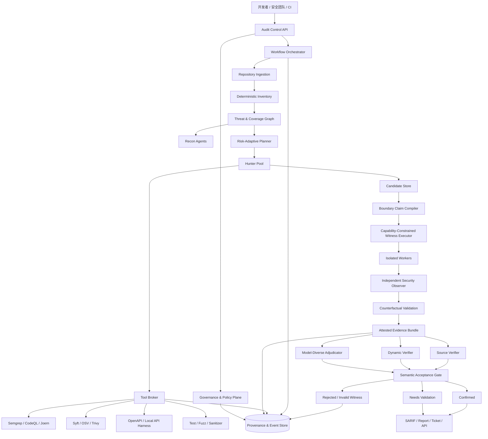

# 工业级可信 LLM 安全审计平台完整方案

## 一、总体结论

当前 Cloudflare Security Audit Skill 更接近一套**严谨的审计规程、Agent 提示模板与结果状态机**，不是完整的工业安全审计产品。

它已经解决了部分“如何组织大模型进行安全审计”的问题：

- 用 Recon、Hunter、Coverage Critic、Verifier 分离职责；
- 用 Coverage Ledger 管理审计范围；
- 区分 `confirmed`、`needs_validation`、`rejected`；
- 要求源码证据、最小复现、独立验证和安全沙箱；
- 使用两个 JavaScript 校验器检查结果结构和账本状态。

但它没有真正实现以下工业能力：

- 没有实际的工具调用控制层；
- 没有内置 SAST、SCA、图分析、模糊测试或 API 测试引擎；
- 没有真正实现其描述的 OS 强隔离沙箱；
- 没有验证攻击测试是否超出了真实攻击者权限；
- JavaScript 校验器只验证结构和状态，不判断漏洞真假；
- Agent 独立性主要依赖提示词和角色分离；
- 没有企业级任务调度、状态数据库、证据签名、审计日志、模型治理和 CI/CD 集成。

因此推荐采用“双轨升级”：

1. **Security Audit Skill v2**：作为便携、低成本、可独立运行的审计策略层。
2. **Industrial Audit Platform**：把 Skill 中依赖自然语言约束的机制，替换成代码强制执行的工业控制平面。

核心原则是：

> Skill 负责告诉系统“应该怎样审计”，平台负责保证系统“只能按照这些规则审计”，安全工具负责提供候选和客观信号，可信验证层负责决定漏洞是否可以被接受。

---

## 二、现有机制的工业问题

### 2.1 Prompt 约束不等于安全控制

Skill 要求：

- 禁止外部网络；
- 使用空环境；
- 目标代码只读；
- Agent 只能写自己的 scratch；
- 证据必须安全提升到 artifacts；
- Hunter 和 Verifier 相互独立。

但这些都是 Markdown 中的文字规则。Skill 自身没有：

- 创建网络命名空间；
- 配置 seccomp、AppArmor 或虚拟机；
- 检查挂载点是否只读；
- 限制 Agent 的工具权限；
- 强制 Agent 不能访问其他 Agent 的文件；
- 验证模型调用是否使用了隔离上下文。

如果宿主 Agent 平台不实现这些能力，Skill 只能选择不执行，无法主动建立安全环境。

**替换机制：Policy Enforcement Runtime**

把 Markdown 规则编译成机器可执行策略：

- 文件系统能力白名单；
- 网络出口策略；
- CPU、内存、进程、磁盘和执行时间配额；
- 工具调用白名单；
- 凭据和环境变量白名单；
- 每个 Agent 独立工作目录和能力令牌；
- 所有访问由可信 Tool Broker 代理。

### 2.2 JavaScript 校验器只能验证结构，不能验证漏洞语义

`validate-findings.cjs` 可以检查：

- 字段是否完整；
- verdict 分支是否合法；
- `needs_validation` 是否错误包含 severity；
- overall severity 是否超过 impact；
- 路径、字符串和集合结构是否合法。

`validate-coverage-ledger.cjs` 可以检查：

- Coverage ID 是否规范；
- 状态转换是否一致；
- Agent ID 和 artifact 路径是否合法；
- evidence 是否属于对应 Agent；
- archived attempt 是否复用了旧 owner 或 artifact。

它们不能检查：

- 源码中的调用路径是否真实存在；
- PoC 是否确实由低权限攻击者触发；
- observed result 是否伪造；
- artifact 是否来自声明的程序版本；
- 修复版本是否不再触发；
- 漏洞是否真正跨越安全边界；
- Verifier 是否真正独立；
- 模型是否受到仓库提示注入影响。

**替换机制：Semantic Acceptance Gate**

除结构校验外，增加：

1. 源码路径可解析性验证；
2. 代码版本与证据哈希绑定；
3. 攻击者能力合规验证；
4. 独立安全属性 Observer；
5. 修复版本和良性输入反事实验证；
6. 证据重放验证；
7. Verifier 独立性验证；
8. 工具结果签名与来源验证。

### 2.3 Agent 独立性只是逻辑独立

当前 Skill 要求使用 fresh verifier，但 fresh agent 不一定意味着真正独立：

- 可能使用同一模型；
- 可能共享系统提示、缓存和错误知识；
- 可能接收 Hunter 已经组织过的偏置证据；
- 可能使用同一套错误工具输出；
- 可能被相同的恶意仓库内容提示注入；
- 可能在相同上下文中形成相关性错误。

多个 Agent 一致不能直接作为多个独立证据。

**替换机制：Diverse Verification Quorum**

候选漏洞至少经过三个相互分离的验证通道：

| 验证通道 | 职责 |
|---|---|
| 源码验证器 | 独立重建入口、传播路径、控制点和敏感操作 |
| 动态证据验证器 | 在能力约束环境中重放测试 |
| 安全属性 Observer | 根据外部状态判断是否发生边界违反 |

高风险候选增加第二模型家族或确定性安全工具作为异构证据。

Verifier 默认只能看到：

- 原始候选命题；
- 原始代码；
- 必要的证据文件；
- 能力和安全属性定义。

不直接接收 Hunter 的完整推理过程，降低确认偏差。

### 2.4 缺少真实的安全工具生态

当前 Skill 主要依赖大模型阅读代码和生成本地验证程序。工业环境中会产生三个问题：

- 大型仓库无法仅靠上下文窗口稳定覆盖；
- 已有确定性工具能力被浪费；
- 无法与企业已有扫描结果、规则库和漏洞管理体系对接。

**完善机制：Tool Broker + Tool Adapter**

第一阶段代码/API 审计接入：

| 工具类别 | 推荐工具 | 作用 |
|---|---|---|
| 代码结构 | Tree-sitter、SCIP/LSIF | 符号、引用、调用关系和跨文件导航 |
| 轻量 SAST | Semgrep | 快速生成候选和组织专用规则 |
| 深度数据流 | CodeQL | 污点传播、跨过程数据流和复杂查询 |
| 程序图 | Joern | CPG、调用路径和跨语言图分析 |
| 依赖与 SBOM | Syft、OSV-Scanner、Trivy | 依赖、已知漏洞和供应链证据 |
| API 解析 | OpenAPI Parser | API、认证方式、参数和资源模型 |
| 本地 API 验证 | Schemathesis 或自研 Harness | 在隔离环境中生成和重放 API 测试 |
| 模糊测试 | libFuzzer、AFL++、Jazzer | 仅用于适用语言和隔离目标 |
| 动态观测 | Sanitizer、审计事件探针 | 内存错误、授权结果和状态变化 |

这些工具不是最终裁决者：

- 工具命中只生成 Candidate；
- LLM 负责上下文理解和假设组合；
- 可信验证层负责接受或拒绝；
- 任何工具都不能直接写最终 Finding。

### 2.5 Coverage Ledger 存在组合爆炸

当前覆盖单元大致由以下维度组合：

\[
Surface \times Boundary \times Subsystem \times AttackClass \times Lifecycle
\]

大型微服务仓库可能产生数千甚至数万单元，并面临：

- 5 MiB JSON 文件上限；
- 单文件读写冲突；
- 无事务保证；
- 多 Agent 并发更新困难；
- 单元粒度难以自动调整；
- 以 Agent 调用次数计费不反映实际成本。

**替换机制：Risk-Adaptive Coverage Graph**

使用图数据库或 PostgreSQL 保存：

- Entry Surface；
- Principal；
- Asset；
- Trust Boundary；
- Control；
- Source/Sink；
- Attack Class；
- Evidence；
- Finding。

Coverage Unit 不再做所有维度的笛卡尔积，而由风险图按需展开：

\[
Priority(u)=Exposure \times AssetValue \times PathReachability
\times ControlUncertainty \times ChangeRisk
\]

保留 Coverage Ledger 的可解释性，但底层替换为事务化事件存储；JSON 仅作为导出格式。

### 2.6 沙箱策略过于理想化

Skill 要求同时满足：

- 无外网；
- 空环境；
- 只读代码和工具链；
- scratch-only 写入；
- 完整资源限制；
- 安全 artifact promotion。

这是正确的安全目标，但在企业项目中可能导致：

- 无法下载构建依赖；
- 无法访问私有包仓库；
- 无法启动依赖数据库；
- 无法验证云 IAM、消息队列或身份服务；
- 大量候选被迫进入 `needs_validation`。

**替换机制：分级执行环境**

| 等级 | 环境 | 允许能力 |
|---|---|---|
| L0 | 纯源码 | 不执行目标代码 |
| L1 | Hermetic Sandbox | 无外网、假数据、只读源码 |
| L2 | Ephemeral Integration Environment | 临时数据库、消息队列和身份模拟器 |
| L3 | Enterprise Staging Replica | 企业授权的隔离预发布环境，只允许观察性测试 |
| L4 | Production Observation | 只允许被动日志和配置验证，禁止主动攻击 |

所有候选必须记录执行等级。低等级无法证明的事实不能被高等级结论替代。

### 2.7 缺少真实攻击者能力约束

当前 Skill 要求 Hunter 描述低信任主体和 starting capability，但没有执行层保证测试没有：

- 直接访问数据库；
- 调用管理员 API；
- 读取内部文件；
- 注入进程内状态；
- 使用测试夹具预置的高权限对象；
- 读取攻击者现实中不可见的信息。

因此可能出现：

> PoC 可以运行，但不是现实攻击者能够执行的 PoC。

**创新替换机制：Capability-Constrained Witness**

每个候选生成机器可执行的 `BoundaryClaim`：

```text
attacker_principal
allowed_credentials
allowed_interfaces
allowed_actions
forbidden_interfaces
protected_resource
security_property
environment_assumptions
success_observation
```

Witness 执行器仅向攻击测试暴露允许的能力。任何超出能力的文件、网络、工具、凭据或内部状态访问都立即终止，并将候选标记为 `invalid_witness`。

这是平台区别于普通多 Agent 漏洞扫描器的核心技术创新。

### 2.8 没有因果性和反事实验证

Skill 要求复现 observed result，但单次 PoC 成功可能来自：

- 环境本身已损坏；
- 测试夹具错误；
- Observer 始终返回成功；
- 修复版本仍产生相同信号；
- 合法操作被误判为越权；
- Agent 只是触发了普通异常。

**创新替换机制：Counterfactual Validation Matrix**

每个候选默认执行：

| 程序 | 主体 | 输入 | 目的 |
|---|---|---|---|
| 漏洞版本 | 攻击主体 | 攻击输入 | 观察安全属性违反 |
| 漏洞版本 | 攻击主体 | 良性输入 | 排除环境持续异常 |
| 修复版本 | 攻击主体 | 攻击输入 | 验证漏洞特异性 |
| 漏洞版本 | 合法主体 | 相同操作 | 区分合法授权和越权 |
| 漏洞版本 | 攻击主体 | 去除攻击因素 | 验证触发因素 |

只有差异符合安全假设时，Candidate 才能被接受。

### 2.9 缺少证据来源和重放保证

现有 artifact 路径约束能降低文件污染风险，但没有完整证明：

- 哪个程序版本生成了证据；
- 哪个模型和工具执行了步骤；
- 环境是否发生变化；
- 日志是否被目标代码伪造；
- 结果是否可以由第三方重放。

**替换机制：Attested Evidence Bundle**

证据包包括：

- 源码提交和 dirty state；
- 构建依赖、容器镜像和工具摘要；
- 模型、提示版本和参数；
- Boundary Claim；
- Tool Broker 调用记录；
- 执行能力策略；
- 输入、轨迹和 Observer 输出；
- 全部反事实对照结果；
- 每项证据的哈希；
- Verifier 决策和身份；
- 最终状态转换历史。

使用哈希链或 Merkle DAG 绑定证据依赖，执行 Worker 使用短期工作负载身份签署 attestation。

### 2.10 缺少企业治理

当前 Skill 没有直接覆盖：

- SSO、RBAC 和租户隔离；
- 数据分类和代码出域策略；
- 模型供应商治理；
- Prompt 和模型版本管理；
- Token、时间和工具成本；
- 审批、例外、抑制和风险接受；
- Jira、GitHub、GitLab、SIEM 和漏洞管理平台；
- SLA、修复状态和回归验证。

**替换机制：Governance Plane**

建立：

- 项目、仓库、团队和租户级 RBAC；
- 模型路由与代码出域策略；
- 运行预算、并发和优先级策略；
- Finding 生命周期；
- 人工审批和风险接受记录；
- 审计日志与留存策略；
- SARIF、CycloneDX、VEX 和企业工单输出；
- 模型、Prompt、规则和工具版本回归评估。

---

## 三、双轨目标架构



架构分为四个安全域：

1. **控制平面**：编排、策略、身份、预算和状态转换。
2. **数据平面**：目标仓库、分析索引、工具输出和模型上下文。
3. **执行平面**：隔离构建、测试、API Harness 和 Witness。
4. **证据平面**：Observer、签名、证据包和最终裁决。

目标代码、仓库文档和模型输出均视为非可信数据，不能直接修改控制平面策略。

---

## 四、Skill v2 轻量方案

Skill v2 不试图独立实现完整平台，而是成为平台无关的审计策略包。

### 4.1 保留机制

- Recon、Hunter、Coverage Critic 和 Verifier；
- `confirmed`、`needs_validation`、`rejected`；
- 结构化 Coverage Ledger；
- 源码优先和信任边界原则；
- 写隔离、artifact promotion 和最小影响验证；
- Profile 和 Budget 概念。

### 4.2 新增机制

- `BoundaryClaim`：攻击主体、能力、资源和安全属性；
- `ToolRequest`：工具、版本、输入、目的、资源上限；
- `WitnessPlan`：最小验证和对照实验；
- `EvidenceManifest`：证据来源和哈希；
- `VerifierIndependence`：模型、上下文、工具和执行环境分离记录；
- `AcceptanceDecision`：每条接受条件的机器可读结论；
- `invalid_witness`：PoC 越权、环境污染或 Observer 无效；
- `inconclusive`：证据冲突且无法安全裁决。

### 4.3 轻量校验器边界

Skill v2 的本地校验器仍只承担：

- Schema；
- 状态机；
- 路径安全；
- 哈希格式；
- 证据引用完整性；
- verdict 和接受条件一致性。

它不能宣称验证漏洞真实性。语义验证必须由平台执行器和 Observer 完成。

---

## 五、工业平台核心接口

### 5.1 `AuditSpec`

定义一次审计：

```text
repository_ref
scope
profile
languages
execution_tier
model_policy
tool_policy
data_egress_policy
budget
risk_threshold
baseline_run
```

### 5.2 `CoverageNode`

替换单文件笛卡尔积账本：

```text
surface
principal
boundary
asset
control
subsystem
attack_class
lifecycle
source_refs
risk_score
state
owner
evidence_refs
```

### 5.3 `Candidate`

```text
candidate_id
source_trace
claimed_boundary
candidate_class
generating_agent
generating_tools
supporting_signals
contradicting_signals
validation_state
```

### 5.4 `BoundaryClaim`

```text
attacker
allowed_capabilities
forbidden_capabilities
target_resource
security_property
assumptions
entry_interface
success_predicate
```

### 5.5 `ToolInvocation`

```text
tool
tool_digest
policy_decision
input_refs
sandbox_profile
start_time
end_time
exit_status
output_refs
resource_usage
```

### 5.6 `EvidenceBundle`

```text
program_identity
environment_identity
boundary_claim
witness_plan
tool_invocations
execution_trace
observer_identity
counterfactual_results
artifact_hashes
attestations
replay_recipe
```

### 5.7 `Finding`

最终状态：

```text
confirmed
needs_validation
rejected
invalid_witness
inconclusive
```

对外报告时可把 `invalid_witness` 和 `inconclusive` 归入非漏洞结果，但内部必须保留，以便分析审计系统自身的失败模式。

---

## 六、真实工业执行流程

### 阶段 0：准入和治理

- 验证仓库权限、数据分类、模型出域策略和审计范围；
- 锁定源码提交、工具版本、Prompt 版本和预算；
- 决定 L0–L4 执行等级；
- 创建隔离运行身份和事件流。

### 阶段 1：确定性资产发现

先由工具完成：

- 语言、框架、构建系统；
- API 路由、RPC、消息入口；
- 身份和授权中间件；
- 数据模型、租户字段和敏感资源；
- 依赖、SBOM 和测试设施；
- 代码所有者和变更范围。

LLM 在这些事实之上补充语义解释，不从零猜测仓库结构。

### 阶段 2：威胁和覆盖图构建

Recon Agent 将确定性事实映射为：

\[
Principal \rightarrow Interface \rightarrow Control
\rightarrow Resource \rightarrow SecurityProperty
\]

Coverage Planner 根据风险和代码变化生成任务，不建立完整笛卡尔积。

### 阶段 3：异构候选生成

Hunter 可以组合：

- 源码深读；
- Semgrep/CodeQL/Joern 信号；
- 依赖漏洞；
- 测试和历史修复；
- API 描述和鉴权矩阵；
- 数据流及跨服务调用。

候选生成与最终裁决完全分离。

### 阶段 4：候选标准化

每个候选必须编译成：

- 明确的 Boundary Claim；
- 最小源码路径；
- 前置条件；
- Witness Plan；
- Observer 需求；
- 对照实验需求。

不能标准化的猜想不进入执行阶段。

### 阶段 5：能力约束执行

Witness 只能通过 Tool Broker 获得声明的接口和权限。执行器记录：

- 请求主体；
- 凭据类型；
- 接口调用；
- 授权决策；
- 资源标识；
- 关键状态变化；
- 任何被拒绝的能力请求。

### 阶段 6：独立安全观察

Observer 在测试进程之外检查：

- 是否访问了非所属资源；
- 是否执行了未授权动作；
- 是否跨越租户或权限边界；
- 是否违反数据流属性；
- 是否只是普通错误或自影响。

### 阶段 7：反事实验证

执行完整对照矩阵。任何下列情况均不得确认：

- 修复版本产生相同安全信号；
- 良性输入同样触发；
- Observer 对所有输入都返回成功；
- 攻击依赖被禁止能力；
- 环境初始状态已经违反安全属性。

### 阶段 8：异构独立验证

源码验证、动态重放和模型复核分别进行。重大结论必须至少有：

- 一项非 LLM 的执行证据；
- 一项独立源码证据；
- 一项安全属性判定。

### 阶段 9：语义接受门控

`confirmed` 必须同时满足：

1. 真实入口；
2. 明确低信任主体；
3. 能力合规；
4. 完整源码路径；
5. 独立 Observer 发现属性违反；
6. 反事实差异成立；
7. 证据绑定精确版本；
8. 独立重放成功；
9. 影响和严重度与证据一致；
10. 没有决定性的未观察部署事实。

### 阶段 10：企业处置

- 自动生成 SARIF 和安全报告；
- 创建工单但不自动标记为已确认，除非门控通过；
- 提供最小修复不变量和回归测试；
- 修复提交后自动重放 Evidence Bundle；
- 记录接受风险、误报、重复项和修复状态。

### 阶段 11：持续学习

只把经过验证的结构化反馈用于：

- Coverage 优先级；
- 工具选择；
- Prompt 和规则回归；
- 误报分类；
- 成本路由；
- 组织特定攻击面知识。

不能直接用未经确认的模型结论自我训练，否则会形成错误反馈闭环。

---

## 七、核心技术创新点

### 创新点 1：攻击者能力约束的漏洞见证

传统 PoC 证明“程序可被某段测试影响”；新机制证明：

\[
\exists \tau:
\tau \in Exec(P,E,X)
\land X \subseteq Cap(A)
\land \neg \Phi(\tau)
\]

即攻击动作必须属于声明攻击者的真实能力。

这是相对于普通沙箱、Agent 复核和 PoC 生成的关键区别。

### 创新点 2：基于安全属性的独立 Observer

漏洞成功不再由 Hunter 的文本或退出码决定，而由独立 Observer 对外部状态进行判定。

这解决“大模型生成攻击、大模型解释结果、大模型再确认自己”的循环自证问题。

### 创新点 3：漏洞验证的反事实矩阵

通过漏洞版、修复版、攻击主体、合法主体、攻击输入和良性输入的组合，建立因果支持。

该机制比单一 Patch 对照更强，因为它同时区分：

- 漏洞因素；
- 权限因素；
- 输入因素；
- 环境因素；
- Observer 错误。

### 创新点 4：风险自适应覆盖图

用动态风险图替代固定笛卡尔积 Coverage Ledger：

- 变更驱动；
- 证据驱动；
- 风险驱动；
- 不确定性驱动；
- 历史误报和真实发现驱动。

目标是在相同预算下提高真实边界覆盖率，而不是简单增加 Agent 数量。

### 创新点 5：多 Agent 独立性的可测量化

把“fresh agent”拆解为四个维度：

\[
Independence =
Model \times Context \times Tool \times Execution
\]

记录验证者是否：

- 使用不同模型；
- 未看到 Hunter 推理；
- 使用独立工具结果；
- 独立重放执行。

由此可以研究 Agent 一致性与真实错误相关性。

### 创新点 6：可证明来源的漏洞证据图

将代码、环境、主体、能力、工具输出、轨迹、Observer 和裁决绑定成可重放证据图。

相比普通报告，它支持：

- 第三方重放；
- 修复回归；
- 模型升级回归；
- 证据过期检测；
- 责任链和审计追踪。

### 创新点 7：控制平面与非可信语义平面隔离

仓库代码、README、Issue、工具输出和 LLM 文本都属于非可信输入，不能改变：

- 能力策略；
- 工具权限；
- Observer；
- 接受规则；
- 证据签名；
- 数据出域策略。

这是将 Agent prompt-injection 防御真正应用到漏洞审计基础设施中。

---

## 八、落地路线

### 第一阶段：Skill v2，4–6 周

交付：

- 扩展 Schema；
- Boundary Claim；
- Tool Request；
- Evidence Manifest；
- 新状态机；
- 接受条件清单；
- 轻量工具适配规范；
- 原有验证器兼容迁移。

目标：在没有平台时改善结果规范，但不宣称强安全保证。

### 第二阶段：平台 MVP，8–12 周

交付：

- 审计 API 和任务编排器；
- PostgreSQL 事件和覆盖存储；
- Repo Ingestion；
- Tree-sitter、Semgrep、CodeQL、SBOM 适配；
- 隔离 Worker；
- Tool Broker；
- SARIF 和报告输出。

目标：支持 Python、TypeScript 和 Web/API 审计。

### 第三阶段：可信验证层，8–12 周

交付：

- Boundary Claim 编译器；
- Capability-Constrained Executor；
- 独立 Observer SDK；
- 反事实验证矩阵；
- Evidence Bundle；
- 重放和 attestation；
- 异构验证门控。

目标：把“可运行 PoC”提升为“可信边界证据”。

### 第四阶段：企业试点，12 周

选择：

- 10–20 个服务；
- 至少两个技术栈；
- 已知历史漏洞、真实负样本和新变更；
- 与现有 SAST 和人工审计对照。

试点期间只自动创建候选和建议，不自动关闭人工安全流程。达到接受指标后再用于 CI 门禁。

---

## 九、验证与测试计划

### 9.1 安全隔离测试

- 恶意仓库尝试读取宿主凭据；
- 构建脚本尝试访问外网；
- 目标进程尝试写入源码和证据目录；
- Agent 尝试访问其他 Agent 的 artifact；
- 符号链接、硬链接、FIFO 和 TOCTOU 证据污染；
- 提示注入尝试修改能力策略和 Observer。

验收：所有越权操作必须被控制平面阻断并留下策略事件。

### 9.2 漏洞语义测试

- 真实跨租户读写；
- 同主体合法访问；
- 只产生异常但不跨边界；
- 修复版本仍产生相似日志；
- 测试框架直接写数据库制造假成功；
- 部署事实缺失；
- Observer 恒真或错误绑定资源。

验收：真实漏洞进入 `confirmed`，越权测试进入 `invalid_witness`，缺少外部事实进入 `needs_validation`。

### 9.3 工具一致性测试

- Semgrep 命中但 CodeQL 不支持；
- CodeQL 有路径但动态结果不成立；
- LLM 候选无工具信号但动态证据成立；
- 多工具重复命中同一根因；
- 工具版本升级造成结果变化。

验收：工具信号只影响候选优先级，不直接控制最终 verdict。

### 9.4 重放测试

- 相同提交和环境重放；
- 修改代码提交后重放；
- 修改 Observer 后重放；
- 模型升级但保持证据不变；
- 构建依赖不可获得；
- 证据包缺失或哈希不一致。

验收：相同绑定条件下结果可复现；绑定对象变化时旧证据自动过期。

### 9.5 工业指标

建议试点门槛：

- 已确认漏洞重放成功率 ≥ 95%；
- `confirmed` 人工复核准确率 ≥ 90%；
- 相比原始 Skill，错误接受率下降 ≥ 40%；
- 重大候选 100% 具有非 LLM 证据；
- 100% 工具调用具有版本和来源记录；
- 100% 高风险结果经过异构验证；
- 单仓库成本、时间和人工复核量可追踪；
- 任何沙箱逃逸或跨租户证据访问均为阻断上线的问题。

这些是试点验收目标，不是对尚未实验系统的效果声明。

---

## 十、关键默认决策

- 采用“平台与 Skill 双轨”，不把所有能力继续堆入 Markdown。
- 第一阶段聚焦代码与 Web/API 审计，优先 Python 和 TypeScript。
- Skill 是策略层，不是可信执行根。
- PostgreSQL 事件存储替代共享 JSON 作为运行时真相源，JSON 保留为可移植导出。
- Semgrep、CodeQL 和 Tree-sitter 作为首批代码工具；Joern 和 fuzzing 按语言逐步接入。
- 所有工具结果仅生成 Candidate，不能直接生成最终 Finding。
- 默认使用 L1 Hermetic Sandbox；需要服务依赖时升级到 L2 临时集成环境。
- 不对生产环境实施主动漏洞验证。
- `confirmed` 必须包含能力合规、独立 Observer、反事实验证和可重放证据。
- 模型推理文本不作为最终安全证据。
- 任何无法从源码或隔离环境确认的关键部署事实进入 `needs_validation`。
- 以误接受率、重放率、人工准确率和成本为核心工业 KPI，而不是以 Agent 数量或报告数量评价效果。

最终工业定位是：

> 从“由多个大模型 Agent 阅读代码并相互复核的审计 Skill”，升级为“由确定性工具发现、LLM 推理、能力约束执行、独立安全属性判定和可重放证据共同组成的可信漏洞审计平台”。
