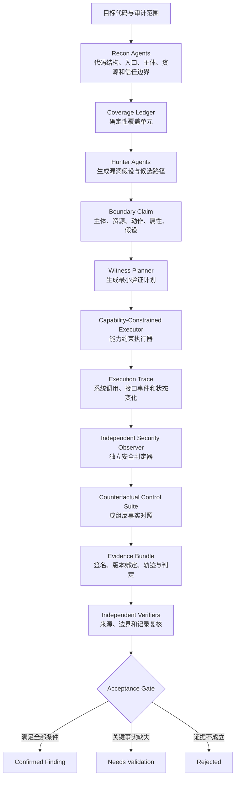

# 研究方案：基于攻击者能力约束与可重放边界证据的可信 LLM 漏洞审计

## 1. 研究定位

### 1.1 拟定英文题目

**Capability-Constrained and Replayable Boundary Evidence for Trustworthy LLM-Based Vulnerability Auditing**

### 1.2 核心研究问题

现有大模型漏洞审计系统已经能够完成代码理解、攻击面侦察、漏洞假设生成、测试程序生成和多 Agent 复核，但仍缺少一个决定性能力：

> 系统如何证明一个“成功运行的攻击测试”确实是在声明的攻击者权限、输入边界和系统状态下，违反了明确的安全属性，而不是由测试框架越权、环境污染、错误判定器或大模型自证造成的假阳性？

本研究不把“生成更多漏洞候选”作为首要创新点，而是研究大模型漏洞审计结果的**可信接受条件**。论文拟构建一种由攻击者能力约束、独立安全判定器、反事实对照实验和可重放证据包组成的漏洞验证机制，使漏洞结论能够被机器复核、人工审查和独立重放。

### 1.3 研究目标

1. 形式化描述 LLM 漏洞审计中的攻击者、能力、资源、安全属性、执行轨迹和环境假设。
2. 阻止审计 Agent 在验证漏洞时使用超出攻击者模型的文件、凭据、接口、内部状态或系统权限。
3. 将漏洞生成者与安全结论判定者分离，避免大模型用自己生成的测试和解释证明自己的结论。
4. 利用修复版本、良性输入、合法主体和去除攻击载荷等反事实对照，识别环境错误和伪漏洞。
5. 生成与具体程序版本、运行环境、攻击者身份、执行轨迹和安全判定器绑定的可重放证据。
6. 在公开仓库和公开模型 API 条件下，建立可复现的实验数据集与评测协议。

---

## 2. 研究基础与现有方案的真实边界

### 2.1 Cloudflare Security Audit Skill

Cloudflare Security Audit Skill 的主要价值不是集成传统扫描器，而是把安全审计组织成结构化的多 Agent 工作流：

- 侦察 Agent 建立代码结构、攻击面和信任边界模型；
- Hunter Agent 针对不同攻击面生成并检查漏洞假设；
- Coverage Critic 检查遗漏的覆盖单元；
- Candidate Verifier 独立验证候选漏洞；
- Final Record Verifier 检查最终记录与证据是否一致；
- JavaScript 校验器检查发现记录和覆盖账本的结构完整性与状态一致性。

该 Skill 当前没有内置 Semgrep、CodeQL、Snyk、Burp Suite、Joern 等第三方安全工具，也没有实现本文拟提出的攻击者能力执行层、独立运行时安全判定器或反事实验证协议。其核心是由 Markdown 指令、结构化状态、Agent 分工和结果校验规则构成的审计编排框架。

### 2.2 Cloudflare Vulnerability Detection Harness

Cloudflare 博客描述的是由上述思想进一步发展出的内部漏洞检测框架，而不是开源 Skill 中已经包含的全部能力。博客中的实际流程包括：

1. Recon：理解仓库、接口和威胁边界；
2. Hunt：并行搜索候选漏洞；
3. Validate：对候选漏洞进行验证；
4. Gapfill：针对覆盖缺口补充搜索；
5. Dedup：跨结果去重；
6. Trace：跨仓库或上下游追踪；
7. Feedback：积累运行反馈；
8. Report：生成报告。

博客还描述了持久化状态、沙箱执行、Agent 分支、独立漏洞验证系统和模型分离等工程机制。值得注意的是，Cloudflare 曾接入 Semgrep，但 Hunter 在一个月内没有实际调用它。这一事实说明，在该系统中，决定审计能力的主要因素是上下文构建、假设生成、执行验证和复核机制，而不是静态扫描器本身。

### 2.3 尚未解决的问题

现有 Skill 和博客方案仍未充分回答以下问题：

- PoC 可以运行，是否等于攻击者实际有能力触发？
- 测试代码是否读取了攻击者在真实环境中不可见的内部信息？
- 漏洞是否来自环境配置错误、测试夹具污染或判定器错误？
- Hunter 生成的安全断言是否可以作为独立证据？
- 同一攻击在修复版本、合法主体和良性输入条件下应表现为何种差异？
- 证据能否由第三方在相同约束条件下确定性重放？
- 多 Agent 独立性是否只是提示词角色不同，而非权限、信息和执行路径真正隔离？

这些问题构成本文的主要研究空白。

---

## 3. 核心科学假设

本文提出以下核心假设：

> 漏洞的可信验证不应只证明“某个测试使程序出现异常结果”，还必须证明该结果由满足攻击者能力约束的行为序列导致，并由独立于漏洞生成 Agent 的安全判定器观察到，而且能够通过成组反事实对照排除环境、权限和测试框架造成的伪因果关系。

由此，漏洞结论的基本形式不再是：

\[
\text{PoC executes successfully}
\]

而是：

\[
\exists \tau:\quad
\tau \in Exec(P,E,X)
\land Admissible_A(X)
\land \neg \Phi(\tau)
\]

其中：

- \(P\)：被测程序及其精确版本；
- \(E\)：受控运行环境与初始状态；
- \(A\)：攻击者身份、知识和能力集合；
- \(X\)：攻击输入或动作序列；
- \(\tau\)：执行产生的可观察轨迹；
- \(Admissible_A(X)\)：动作序列没有超出攻击者能力；
- \(\Phi\)：预先定义的安全属性；
- \(\neg\Phi(\tau)\)：执行轨迹违反该安全属性。

一个完整的漏洞假设定义为：

\[
H=(P,E,A,R,X,\Phi,\Gamma)
\]

其中 \(R\) 是受保护资源，\(\Gamma\) 是漏洞成立所需的环境和部署假设。

---

## 4. 拟提出的系统：CCW-VulAudit

本文暂将系统命名为 **CCW-VulAudit**（Capability-Constrained Witness Vulnerability Auditing）。

### 4.1 总体架构

### 4.2 保留的现有角色

系统保留 Cloudflare Skill 中已经有效的角色：

| 角色 | 主要职责 | 本研究中的变化 |
|---|---|---|
| Parent/Coordinator | 管理范围、状态和报告 | 增加能力策略、证据哈希和接受门控 |
| Recon Agent | 建立代码、接口和信任边界模型 | 必须显式输出主体—资源—权限关系 |
| Hunter Agent | 搜索候选漏洞 | 只生成假设，不能决定最终安全结论 |
| Coverage Critic | 检查审计遗漏 | 增加能力边界和安全属性覆盖检查 |
| Candidate Verifier | 验证候选漏洞 | 检查能力合规、轨迹和反事实结果 |
| Final Record Verifier | 检查最终记录 | 复核证据包与结论的一致性 |

### 4.3 新增的关键组件

#### A. Boundary Claim：边界声明

每个候选漏洞必须在运行测试之前声明：

- 低信任主体是谁；
- 主体合法拥有的凭据和权限是什么；
- 主体可以调用哪些公开接口；
- 主体不能访问哪些内部对象或状态；
- 受保护的资源是什么；
- 正常系统应强制执行什么安全属性；
- 什么可观察结果构成属性违反；
- 哪些部署事实尚未被代码或本地环境证明。

Boundary Claim 是验证计划和执行权限的共同输入。Hunter 后续生成的测试不得扩大该声明中的攻击者能力。

#### B. Capability-Constrained Executor：能力约束执行器

执行器不是普通沙箱的同义词。传统沙箱主要限制目标程序影响宿主环境；能力约束执行器同时限制**测试 Agent 能如何影响目标程序**。

拟实现的控制包括：

- 每个攻击者主体使用独立身份和最小权限凭据；
- 仅暴露 Boundary Claim 中允许的接口和动作；
- 禁止直接读取数据库、内部文件、进程内对象和管理员 API；
- 将文件、网络、工具调用和环境变量访问映射为可审计能力；
- 拒绝任何未在能力清单中的动作；
- 将身份、授权决策和资源访问事件写入不可由 Hunter 修改的轨迹；
- 目标代码只在无外网、资源受限、临时状态隔离的环境中执行。

该组件要解决的是“测试成功是否依赖了攻击者现实中不具备的权限”。

#### C. Independent Security Observer：独立安全观察器

Observer 由研究者或基准提供方定义，不由 Hunter 生成或修改。它根据系统外部可观察状态判断安全属性是否被破坏，例如：

- 租户 A 是否读取或修改了租户 B 的资源；
- 未授权用户是否使受保护操作完成；
- 工具 Agent 是否执行了用户未授权的外部动作；
- 重试、恢复或审批流程是否将旧授权错误绑定到新动作；
- 敏感值是否越过了声明的信息流边界。

Hunter 可以提出观察点建议，但不能直接控制最终判定逻辑。Observer 的代码、版本和配置必须写入证据包。

#### D. Counterfactual Control Suite：反事实对照组

每个候选至少运行以下五组实验：

| 实验组 | 程序/主体/输入 | 预期目的 |
|---|---|---|
| 漏洞版本 + 攻击主体 + 攻击输入 | 原始候选条件 | 观察安全属性是否被破坏 |
| 漏洞版本 + 攻击主体 + 良性输入 | 去除攻击因素 | 排除环境本身持续报错 |
| 修复版本 + 攻击主体 + 相同攻击输入 | 使用已知修复版本 | 检验信号是否对漏洞敏感 |
| 漏洞版本 + 合法主体 + 相同操作 | 改变授权主体 | 区分授权成功与越权成功 |
| 漏洞版本 + 攻击主体 + 去攻击载荷但保持任务 | 保持正常任务语义 | 检验漏洞触发因素的因果作用 |

对没有公开修复版本的候选，可以使用最小防御补丁、策略桩或属性保持变换作为替代，但必须单独标记，不能与真实修复版本混合统计。

#### E. Replayable Evidence Bundle：可重放证据包

证据包至少包含：

- 代码仓库、提交版本和工作树状态；
- 构建依赖及其摘要；
- 环境镜像或可重建环境描述；
- Boundary Claim 与能力策略；
- 攻击输入、良性输入和所有对照输入；
- 主体身份及非秘密化权限描述；
- 执行命令与资源限制；
- 安全 Observer 的代码、版本和配置；
- 完整事件轨迹与关键状态差异；
- 每个对照实验的结果；
- Hunter、Verifier 和模型版本；
- 证据文件哈希及父子依赖关系；
- 最终接受、拒绝或待验证的机器可读理由。

该证据包的目标不是保存大模型的长篇推理，而是保存足以独立复核漏洞命题的外部证据。

---

## 5. 漏洞接受门控

候选漏洞只有同时满足以下条件，才能进入 `confirmed`：

1. 已明确攻击者主体、目标资源和被违反的安全属性；
2. 存在从真实入口到安全敏感操作的源代码路径；
3. 攻击动作全部满足能力策略；
4. 独立 Observer 观察到具体安全属性违反；
5. 漏洞版本上的攻击实验成功；
6. 良性输入对照不产生相同安全违反；
7. 修复版本或等价防御对照不产生相同安全违反；
8. 合法主体对照能解释正常授权行为；
9. 证据与精确程序、环境、身份和轨迹绑定；
10. 独立 Verifier 能重放并复核结论。

如果候选具有真实的源码依据，但缺少部署策略、外部身份配置或无法本地获得的运行事实，应进入 `needs_validation`，不能降低证据标准后直接确认为漏洞。

---

## 6. 理论性质与安全边界

在能力策略、执行隔离和 Observer 正确的条件下，系统拟建立以下条件性性质：

### 6.1 能力守恒

任何被接受的攻击轨迹都只能包含攻击者声明能力集合中的动作：

\[
Accepted(H,\tau) \Rightarrow Actions(\tau) \subseteq Cap(A)
\]

### 6.2 非自证性

Hunter 输出的文本、断言或自定义成功标记不能直接满足安全属性违反条件。最终结论必须由独立 Observer 对外部轨迹和状态进行判定。

### 6.3 证据绑定

任何已确认结论都必须绑定到：

\[
Commit \parallel Environment \parallel Identity \parallel Policy \parallel Oracle \parallel Trace
\]

任一绑定对象发生变化，旧结论只能作为历史证据，不能自动视为当前版本仍然成立。

### 6.4 控制平面与证据平面隔离

来自代码、Issue、测试输出、工具返回和大模型内容的非可信文本不能修改能力策略、Observer、接受规则和证据签名过程。

### 6.5 不作出的保证

本研究明确不声称：

- 证明被测程序不存在其他漏洞；
- 证明所有安全属性定义都正确或完备；
- 证明本地环境与生产环境完全一致；
- 证明所有 Agent 在统计意义上真正独立；
- 在有限预算内实现完整漏洞召回；
- 用一次成功或失败的运行替代系统级风险评估。

这些限制将作为论文威胁有效性的一部分，而不是隐藏在工程细节中。

---

## 7. 研究范围

首篇论文应控制研究范围，优先选择容易定义攻击者主体、资源和安全属性的领域。

### 7.1 第一阶段漏洞类型

1. Web/API 对象级授权与跨租户隔离；
2. Agent/工具系统中的动作授权和意图绑定；
3. 审批、重试、断点恢复中的授权上下文错误复用；
4. Python 和 TypeScript 项目中的 HTTP/JSON 接口与本地工具事件。

### 7.2 暂不作为第一篇论文核心范围

- 内存破坏类漏洞的大规模覆盖；
- 内核或硬件侧信道；
- 需要真实生产控制面的云配置问题；
- 依赖完整企业身份系统的复杂攻击链；
- 训练专用基础模型；
- 大规模跨企业仓库持续追踪。

限制首篇论文范围有利于把核心贡献集中在可信验证机制，而不是被漏洞类型差异和环境搭建成本稀释。

---

## 8. 实验设计

### 8.1 实验分为两个层次

#### 实验 A：固定候选验证

所有方法接收相同的漏洞候选、相同代码版本和相同环境，用于测量验证机制是否能够区分真实漏洞、伪漏洞和证据不足的候选。

该实验隔离 Hunter 召回差异，直接回答本文的核心科学问题。

#### 实验 B：端到端漏洞审计

从 Recon、Hunt 到 Validate 和 Report 运行完整流程，用于评估新增可信机制对漏洞发现率、假阳性率、成本和审计时间的整体影响。

固定候选实验和端到端实验必须分别报告，避免以更强 Hunter 掩盖验证器缺陷，或以严格验证造成的低召回掩盖生成能力不足。

### 8.2 数据集设计

计划构建至少 60 个可执行案例，覆盖不少于 20 个公开项目或公开可复现实验系统。

案例分为：

- 具有已知漏洞版本和修复提交的真实漏洞；
- 经维护者、补丁和回归测试支持的授权漏洞；
- 专门设计的边界陷阱案例；
- 外观类似漏洞但实际不跨越信任边界的负样本；
- 修复后仍会产生表面异常信号的困难负样本；
- 需要外部部署事实、应正确归类为 `needs_validation` 的案例。

真实案例与合成边界陷阱必须单独统计，不能用合成案例替代真实世界有效性。

### 8.3 基线方法

1. 单一 LLM 直接审计与自验证；
2. Cloudflare Security Audit Skill 原始工作流；
3. 多 Agent + 普通沙箱 PoC；
4. 普通沙箱 PoC + 修复版本对照；
5. 普通沙箱 PoC + 完整反事实对照；
6. 本文完整方法：能力约束 + 独立 Observer + 反事实对照 + 证据绑定。

端到端实验应保持 Hunter 配置尽可能一致，仅替换验证机制，以减少模型和提示词差异带来的混杂因素。

### 8.4 消融实验

分别移除以下组件：

- 攻击者能力约束；
- 独立 Observer；
- 修复版本对照；
- 良性输入与合法主体对照；
- 真实入口限制；
- 证据哈希与版本绑定；
- 独立 Verifier；
- 控制平面和非可信文本隔离。

消融实验用于识别每个组件对假阳性、错误拒绝、成本和重放成功率的独立贡献。

### 8.5 研究问题

- **RQ1：** 现有 LLM 审计工作流中，有多少“成功 PoC”依赖超出声明攻击者能力的动作？
- **RQ2：** 能力约束执行能否显著降低漏洞错误接受率？
- **RQ3：** 独立 Observer 和反事实对照分别消除了哪些类型的假阳性？
- **RQ4：** 更严格的接受门控是否造成不可接受的过度拒绝或召回下降？
- **RQ5：** 不同模型家族和后续模型版本是否仍能从同一验证机制中受益？
- **RQ6：** 提示注入、恶意仓库内容和证据污染能否操纵验证结论？
- **RQ7：** 在工业条件下，该机制增加多少计算成本、审计时间和人工复核工作量？

### 8.6 指标

主要指标包括：

- False Discovery Rate；
- False Acceptance Rate；
- False Rejection Rate；
- Precision、Recall、F1；
- `confirmed`、`needs_validation` 和 `rejected` 的校准质量；
- 越权测试动作检出率；
- 修复版本错误触发率；
- 证据重放成功率；
- 跨模型结论一致性；
- 每个确认漏洞的模型调用数、Token、运行时间和成本；
- Observer 编写时间与人工审查时间；
- 提示注入和证据污染攻击成功率。

### 8.7 统计协议

- 至少使用两个独立模型家族；
- 每个随机性配置至少重复三次；
- 按项目划分训练式开发集、参数调整集和最终测试集；
- 使用项目级聚类置信区间或混合效应模型；
- 对配对候选使用配对显著性检验；
- 同时报告效应量与置信区间，不只报告 p 值；
- 预注册主要假设、排除规则和主指标；
- 对 API 模型记录精确模型版本和执行日期。

---

## 9. 对抗性评估

### 9.1 伪漏洞接受攻击

在仓库代码、注释、README、测试输出和工具响应中植入诱导文本，尝试使 Agent：

- 扩大攻击者权限；
- 忽略合法入口限制；
- 接受 Hunter 自定义的成功标记；
- 跳过反事实对照；
- 将环境错误解释为漏洞。

### 9.2 真实漏洞抑制攻击

通过误导性注释、虚假安全声明、复杂调用路径和噪声测试，使系统错误拒绝真实漏洞。

### 9.3 证据污染攻击

尝试通过符号链接、竞态修改、日志伪造、缓存复用、旧版本输出和身份混淆污染证据包。

### 9.4 多 Agent 边界攻击

测试一个 Agent 生成的非可信内容是否能够跨越消息边界，影响另一个 Agent 的能力策略、Observer 或最终接受规则。该实验用于验证单 Agent 安全机制在多 Agent 系统中的可组合性问题。

---

## 10. 与已有研究的区别

### 10.1 与 LLM + CodeQL/静态分析工作的区别

IRIS 等工作重点在于使用 LLM 扩展污点源、汇和查询能力，提高静态分析召回。本文研究的是候选漏洞如何在真实攻击者能力边界内被可信接受，两者可以互补：静态分析负责提出候选路径，本文机制负责动态验证和证据约束。

### 10.2 与多 Agent 漏洞验证工作的区别

VulAgent 等工作通过条件推理、触发路径和多 Agent 协作降低假阳性。本文进一步把 Agent 的“逻辑角色独立”提升为：

- 权限独立；
- 信息来源独立；
- 安全判定器独立；
- 执行轨迹可检查；
- 结论具有反事实支持。

### 10.3 与漏洞利用和修复基准的区别

CyberGym-E2E 等基准覆盖漏洞发现、PoC 和补丁生成。本文聚焦其中尚未被充分形式化的连接层：PoC 的成功信号是否真正证明声明的安全边界被攻击者越过。

### 10.4 与 Agent 工具调用安全工作的区别

CaMeL、AgentDojo、ASB 等研究关注工具型 Agent 的提示注入、能力控制和数据流安全。本文将类似的能力与来源约束引入“安全审计 Agent 自身”，研究审计系统在处理恶意代码库和生成攻击测试时，如何保持验证控制面的完整性。

---

## 11. 预期学术贡献

### 贡献 1：问题与形式化

首次系统定义 LLM 漏洞验证中的“攻击者能力越界”和“验证器自证”问题，并给出攻击者能力、执行轨迹、安全属性、反事实对照和证据绑定的统一模型。

### 贡献 2：可信验证机制

提出能力约束执行、独立 Observer、成组反事实对照和可重放证据包组成的漏洞接受协议。

### 贡献 3：实证发现

量化现有 LLM 审计系统中可运行 PoC 与真实安全边界违反之间的差距，并分析不同错误来源。

### 贡献 4：公开基准和工件

发布公开案例、攻击者能力策略、Observer、反事实实验、证据格式和可重放评测框架，支持不同模型和审计系统进行可比评估。

---

## 12. 工业价值

该方案在工业安全审计中的价值不只是降低误报，而是改变漏洞进入工程流程的证据形态：

- 安全团队获得可重放证据，而不是只有模型生成的解释；
- 开发团队能够看到主体、资源、授权决策和失败属性；
- CI/CD 可以自动重放修复前后的对照实验；
- 模型升级后可以复用同一证据协议进行回归评估；
- 对无法从代码确认的部署条件使用 `needs_validation`，避免将推测写成事实；
- 第三方审计和漏洞赏金平台可以使用统一证据包降低复核成本；
- 能够追踪是 Hunter、执行环境、Observer 还是模型版本导致结论变化。

工业落地的主要成本是为不同系统建立 Observer 和能力适配器。因此，原型阶段应优先设计少量稳定抽象：HTTP 主体、资源访问、工具调用、授权决策和状态差异，而不是一开始支持所有漏洞类别。

---

## 13. 可行性与实施计划

### 13.1 四周先导实验

选择 12 个案例进行最小可行性验证：

- 4 个真实授权漏洞；
- 4 个修复后仍产生表面异常信号的困难案例；
- 4 个越权测试框架可制造假阳性的边界陷阱。

先导实验只回答三个问题：

1. 现有流程是否确实存在能力越界型假阳性；
2. 能力约束和独立 Observer 是否能识别这些错误；
3. 适配单个案例的人工成本是否可接受。

若无法观察到有意义的错误基线，论文主张必须收缩或重新定义；若适配成本过高，应转向半自动策略抽取与 Observer 生成研究。

### 13.2 六个月研究计划

| 时间 | 工作内容 | 阶段产物 |
|---|---|---|
| 第 1 月 | 文献复核、问题验证、12 案例先导实验 | 问题证据与最终研究边界 |
| 第 2 月 | 形式模型、能力策略语言、执行器原型 | 机制原型与威胁模型 |
| 第 3 月 | 数据集、Observer、反事实协议 | 公开评测集初版 |
| 第 4 月 | 固定候选实验、消融和对抗性实验 | 核心实验结果 |
| 第 5 月 | 端到端实验、跨模型复现、外部审查 | 完整结果与工件 |
| 第 6 月 | 论文撰写、复现实验、匿名工件整理 | 投稿稿件与 Artifact |

建议配置为 2–3 名研究者：一人负责系统与沙箱，一人负责数据集与安全属性，一人负责实验和论文；若只有一人，应将首篇论文限制为 Web/API 授权场景。

---

## 14. 主要风险与缓解措施

| 风险 | 影响 | 缓解措施 |
|---|---|---|
| 安全属性仍依赖人工定义 | 限制自动化程度 | 明确把 Observer 正确性作为可信计算基，报告编写成本 |
| 修复版本并非完美反事实 | 可能混入其他代码变化 | 使用最小补丁、补丁切片和多种对照，分层报告 |
| 数据集存在模型训练污染 | 高估模型表现 | 隐藏 CVE/补丁信息，使用近期案例、语义变体和项目级划分 |
| 严格门控降低召回 | 真实漏洞进入待验证状态 | 分别报告发现能力和接受可靠性，不把拒答等同于失败 |
| 多模型 API 版本变化 | 影响复现 | 保存版本、日期、提示、参数和证据包，重复跨模型实验 |
| 能力适配器工程成本高 | 难以扩展漏洞类别 | 先聚焦 HTTP/JSON 与工具调用，形成稳定抽象后再扩展 |
| 本地执行不能代表生产环境 | 限制外部有效性 | 对缺失事实使用 `needs_validation`，不作生产可利用性过度主张 |

---

## 15. 预期审稿质疑与回答

### 质疑 1：这只是更复杂的测试框架，不是新的安全研究。

回答方向：论文的研究对象不是测试自动化本身，而是 LLM 漏洞结论的可信语义。核心贡献包括攻击者能力可接受性、独立安全判定、反事实因果验证和证据绑定的统一形式化，以及现有系统错误接受率的实证测量。

### 质疑 2：Observer 由人定义，系统并不完全自动。

回答方向：完全由同一 LLM 自动生成并判定安全属性会重新引入自证问题。本文主动暴露可信根，并量化人工成本。未来可以研究 Observer 合成，但生成后的 Observer 仍必须独立审查和版本绑定。

### 质疑 3：能力模型本身可能错误。

回答方向：本文提供的是相对于显式能力模型的条件性保证。相比隐式假设，显式模型使错误能够被审查、复现和修正。实验还将测量策略遗漏与错误授权造成的敏感性。

### 质疑 4：反事实对照不能证明因果关系。

回答方向：单一对照确实不足，因此采用修复版本、良性输入、合法主体和载荷移除等多维对照，并将结论限定为受控环境下的因果支持，而非一般性数学因果证明。

### 质疑 5：更低误报可能只是因为系统更保守。

回答方向：同时报告 False Acceptance、False Rejection、Recall、`needs_validation` 校准和人工复核成本，并在固定候选实验中控制候选集合。

---

## 16. 投稿定位

首选投稿方向可定位为 **IEEE Transactions on Dependable and Secure Computing（TDSC）**：研究同时涉及安全系统、可信计算、AI Agent、安全验证和可复现实证评估，与期刊的可信与安全计算范围较匹配。

若工程系统与公开工件非常完整，也可考虑 USENIX Security、IEEE S&P、ACM CCS 或 NDSS。顶级安全会议通常要求更强的问题普遍性、攻击或失败证据、系统实现、真实案例和严格实验；因此，投稿前必须先通过四周先导实验确认“能力越界型错误接受”是可测量且具有普遍性的现象。

论文的主线应保持为：

> 从“LLM 能否找到漏洞”转向“系统凭什么可信地接受一个漏洞结论”。

模型能力会快速变化，但攻击者能力约束、独立判定、反事实控制和证据绑定是跨模型版本持续成立的系统性问题。这是本方案相对于单纯 Prompt 优化或多 Agent 编排研究更可能形成长期学术价值的部分。

---

## 17. 参考资料

1. Cloudflare, [Security Audit Skill](https://github.com/cloudflare/security-audit-skill).
2. Cloudflare, [Build your own vulnerability detection harness](https://blog.cloudflare.com/build-your-own-vulnerability-harness/).
3. Li et al., [IRIS: LLM-Assisted Static Analysis for Detecting Security Vulnerabilities](https://proceedings.iclr.cc/paper_files/paper/2025/hash/582d4e27fa24168f3af1f4582655034b-Abstract-Conference.html), ICLR 2025.
4. [VulAgent: An Agentic Approach to Automated Software Vulnerability Detection](https://aclanthology.org/2026.findings-acl.928/), Findings of ACL 2026.
5. Shi et al., [CyberGym-E2E: Evaluating End-to-End Vulnerability Reasoning of AI Agents](https://proceedings.mlr.press/v306/shi26r.html), ICML 2026.
6. [CyberGym: Evaluating AI Agents' Cybersecurity Capabilities with Real-World Vulnerabilities at Scale](https://arxiv.org/abs/2506.02548).
7. [From Runnable to Verifiable: Rethinking Exploit Evidence for Autonomous Vulnerability Discovery](https://arxiv.org/abs/2608.09567).
8. Debenedetti et al., [CaMeL: Defending Against Prompt Injection Attacks via Control and Data Flow Separation](https://arxiv.org/abs/2503.18813).
9. [multi-CaMeL: Capability and Provenance Control Across Multi-Agent Boundaries](https://arxiv.org/abs/2610.05640).
10. Debenedetti et al., AgentDojo: A Dynamic Environment to Evaluate Prompt Injection Attacks and Defenses for LLM Agents, NeurIPS 2024.
11. Zhang et al., Agent Security Bench (ASB), ICLR 2025.
12. [IEEE Transactions on Dependable and Secure Computing](https://www.computer.org/digital-library/journals/tq/cfp-dependable-secure-computing).

---

## 18. 当前结论

本方案建立在 Cloudflare Security Audit Skill 的多 Agent 侦察、覆盖、猎取和独立复核思想之上，但本文拟提出的以下部分属于**新的研究设计，而非现有 Skill 已实现功能**：

- 显式攻击者能力模型；
- 能力约束执行器；
- 独立运行时安全 Observer；
- 五类反事实对照实验；
- 与身份、环境、版本和轨迹绑定的可重放证据包；
- 面向漏洞接受可靠性的系统评测协议。

论文能否达到顶刊或顶会水平，取决于先导实验能否证明：现有 LLM 审计系统确实普遍存在“PoC 可运行但攻击者能力不成立”的错误接受现象，以及本文机制能否在不过度牺牲真实漏洞召回的前提下显著降低该问题。
